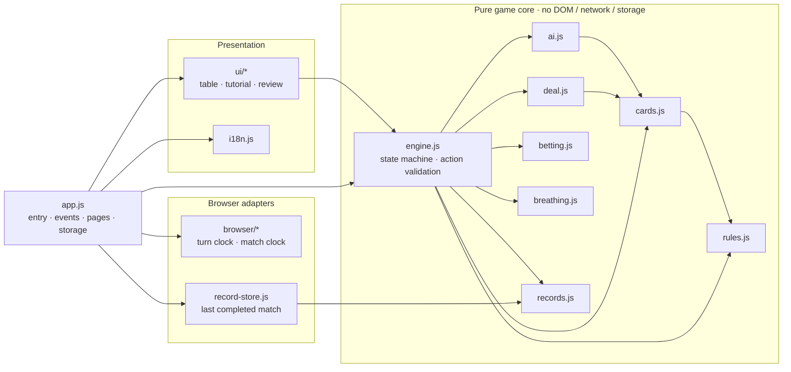

<p align="center">
  <a href="README.md">简体中文</a> · <strong>English</strong> · <a href="README.ja.md">日本語</a>
</p>

<p align="center">
  
</p>

<h1 align="center">Air Poker</h1>

<p align="center"><strong>Your next breath is on the table.</strong></p>

<p align="center">
  Number-based hands · Hidden information · Air wagers<br>
  A single-player browser strategy game told through ink, paper and motion
</p>

<p align="center">
  <a href="https://wychmod.github.io/air-poker/"><strong>Play now →</strong></a> ·
  <a href="#core-gameplay">Gameplay</a> ·
  <a href="#architecture-and-engineering">Engineering</a> ·
  <a href="#contributing">Contributing</a>
</p>

<p align="center">
  <a href="https://github.com/wychmod/air-poker/actions/workflows/ci.yml"></a>
  <a href="https://github.com/wychmod/air-poker/actions/workflows/pages.yml"></a>
  
  
  <a href="LICENSE"></a>
</p>

---

## Overview

**Air is both your stake and your time to survive.**

You and the Opponent each hold five private number cards. Build poker hands from a shared deck, decide when to press or retreat, and preserve the cards and air you will need later. Each number sets the required sum of a five-card hand. Poker ranks decide the showdown, while every wager changes your reserve for future breaths. After five rounds, play moves into endurance; the outcome follows actual air supply and survival time.

Most poker games ask one question: is this hand strong enough?

Air Poker asks a second: **how much time do you have left?**

The 25 canisters each side receives play both roles. They are chips on the table and air in your lungs. Winning the pot does not mean winning the match.

Built with native HTML, CSS and JavaScript, the game runs entirely in your local browser without an account or game backend. **The interface supports Chinese and English; this README is available in Chinese, English and Japanese.**

## Interface

|                                                                Showdown                                                                 |                                                           Match review                                                           |
| :-------------------------------------------------------------------------------------------------------------------------------------: | :------------------------------------------------------------------------------------------------------------------------------: |
|  |  |
|                                             Revealed cards, actual stakes and AIR accounts                                              |                                     Round facts, individual transfers and an event timeline                                      |

The interface uses paper white as its ground and ink black as its structure, preserving line art, halftones, paper grain and underwater light. Every number, card, control and ledger entry is rendered from real state. No full-page mockup with sample data is presented as a playable screen.

## Core gameplay

| Element               | Current rules                                                                                                                                                                                                                                                                           |
| --------------------- | --------------------------------------------------------------------------------------------------------------------------------------------------------------------------------------------------------------------------------------------------------------------------------------- |
| Starting resources    | Each side receives **25 canisters of AIR**. One opens immediately for breathing, leaving 24 available to wager.                                                                                                                                                                         |
| Numbers and hands     | Spend one number card per round and construct **5 distinct, unused physical cards** whose values add up to that number. A=1; J/Q/K=11/12/13.                                                                                                                                            |
| Shared deck           | Both sides independently build from the same remaining 52-card deck and may overlap within a round. Cards in valid hands enter the public discard pile and cannot be reused later.                                                                                                      |
| Alternating bets      | Check, call, raise, fold or make a legal all-in. A raise first covers the call, then adds at most half the post-call pot. Two consecutive checks end betting.                                                                                                                           |
| Showdown and calamity | Standard five-card poker ranks decide the result. When both hands are valid, share at least one physical card and the result is not a tie, the loser burns additional air, capped by the smaller of their round investment and remaining unopened reserve.                              |
| Live breathing        | Each canister supplies approximately **300 seconds** of air and is replaced automatically when empty. Opened canisters cannot be wagered. Hand construction allows **60 seconds**; each player betting turn allows **30 seconds**.                                                      |
| Endurance             | Five completed rounds, insufficient resources to match an ante and other terminal conditions lead to endurance, with optional fast-forward. After supply runs out, a **10-second digital grace period** applies. The first side to exhaust it loses; simultaneous exhaustion is a draw. |

**A round in motion:** Choose a number → Build five cards → Lock the hand and post the ante → Alternate bets → Reveal and settle.

Select cards freely, or load one of up to three recommendations and edit it. A higher number does not mean a stronger hand. Even a strong hand may consume cards needed later or expose you to overlap risk.

### Worked example

If the target is **17**, you can choose **A, 2, 3, 4 and 7**:

```text
A + 2 + 3 + 4 + 7 = 17
```

Getting the sum right is only the first step. The hand must also consist of five distinct, real and unused physical cards, and it still has to beat other valid hands at showdown.

Giving up, timing out or submitting an invalid hand counts as a construction failure and consumes no physical cards. If nobody folds, a single failure loses the pot; two failures repeat the same round without another ante or betting phase. If both numbers are mathematically impossible, investments are refunded and endurance begins. See the [current digital rules](doc/rules/current.md) for full cases.

## Features

| Feature                         | What it brings                                                                                                                                                                |
| ------------------------------- | ----------------------------------------------------------------------------------------------------------------------------------------------------------------------------- |
| Ink, paper and motion           | White space, line art, halftones and grayscale water effects form a consistent visual language. Plays, payments, reveals and calamity effects follow actual game events.      |
| One reserve, two purposes       | Unopened air funds both wagers and future breathing, linking immediate hand strength to long-term survival.                                                                   |
| An information-limited Opponent | The Opponent locks its selection before you choose and decides using only its own private information, public numbers, discards and betting history.                          |
| From tutorial to review         | Eight views cover home, introduction, standalone tutorials, battle, victory, defeat, draw and a complete match review.                                                        |
| Traceable air accounting        | Inspect round targets, construction attempts, event timelines and individual transfers, then export JSON. Accounts continuously reconcile the original 50 canisters.          |
| Adjustable motion               | Disable effects or follow the system's reduced-motion preference. Settings also offer a standalone motion demo with pause, scrubbing and comparison against the source image. |

Only the **most recent completed match** is saved locally, and it is replaced when another match finishes. Refreshing does not restore an unfinished game. Disabling motion, viewing rules or records, switching language or moving to the background does not pause breathing or reset action deadlines.

## Origin and inspiration

This project adapts the **Air Poker arc in volumes 40–43 of Toshio Sako's manga Usogui (嘘喰い / 噬谎者)**. It is a noncommercial fan learning project that brings the tension of number-based hand construction, limited information and air wagers into an interactive browser experience.

Its visual direction is a moving manga on white paper: panels, line work and underwater light create atmosphere, while readable cards, numbers and controls stay in the foreground.

The digital adaptation combines the original upper- and lower-level roles into one player. Automatic canister replacement, fixed construction deadlines, a fixed grace period and the transition to endurance when both targets are impossible are explicit digital conventions. See the [source and adaptation audit](doc/rules/audit.md) for references and differences.

## Quick start

Install **Node.js 22 or later** with npm, and use a modern browser that supports ES modules.

```sh
git clone https://github.com/wychmod/air-poker.git
cd air-poker
npm ci
npm start
```

Open **[http://127.0.0.1:4173](http://127.0.0.1:4173)** in your browser. If you already downloaded the repository, run `npm ci` and `npm start` from its root. Set the `AIR_POKER_PORT` environment variable to use a different port.

Access the game through the local HTTP server so that ES modules load correctly. There is no code compilation step and no third-party game runtime package. The home-page visit counter uses a remote image.

### Your first match

1. Choose “How to play” on the home page to explore numbers, wagers and calamity.
2. Choose “Try the tutorial” to practise in an independent tutorial.
3. Choose “Enter the match”, select and confirm a number, then build a hand, bet and reveal.
4. After the match, open the review to inspect decisions and air movements or export a record. “Last completed match” on the home page reopens the saved result.

## Architecture and engineering

The game core is strictly separated from the browser environment. `game/` does not access the DOM, network, storage, timers or Node platform APIs, so it can be imported and tested without a browser. Views consume public snapshots only; browser modules own clocks, archives and render scheduling.



`createGame()` owns the private match state and exposes four entry points:

- `getState()` returns an independent snapshot that hides the Opponent's future numbers and unrevealed hand.
- `getRecord()` returns the complete record on demand while continuing to hide unrevealed Opponent hands.
- `dispatch(action)` accepts legal actions for the current phase. Repeated confirmations, illegal phases and stale actions cannot change state or charge twice.
- `reset()` starts a new match, with action IDs continuing across restarts.

- **Rules are pure functions; state has one source of truth.** Hand ranking, betting legality, air supply and ledger facts run without a browser, so tests do not depend on the page.
- **Privacy is enforced at the data boundary.** `getState()` never gives the view the Opponent's future numbers, unrevealed hand or proof hands. The presentation layer cannot "peek."
- **Actions carry identity; timeouts fire once.** `sessionId`, `attemptId` and `turnId` fence restarts, rebuilds and stale callbacks, preventing duplicate confirmation and settlement.
- **Time is absolute.** Background recovery, paused motion or a language switch cannot extend a real deadline. One long recovery and many small steps produce the same state.
- **The air ledger can be replayed.** Every transfer keeps the five account balances before and after it, with a constant total of 50. The recorder stores facts without influencing Opponent decisions or settlement.
- **Static does not mean unstructured.** The architecture checker parses static imports, rejects computed module paths and enforces layer boundaries. Releases follow an explicit allowlist.
- **Presentation is decoupled from play.** Canvas effects consume public events only. Animation completion cannot charge AIR or settle a round; hidden pages stop drawing and re-sync the engine on return.

See the [architecture and rule boundaries](doc/harness/architecture.md) for the full state flow, dependency matrix and platform constraints.

## Development and deployment

| Command                | Purpose                                                                                                                 |
| ---------------------- | ----------------------------------------------------------------------------------------------------------------------- |
| `npm test`             | Run regression tests for game rules, the engine, accounting and development checkers.                                   |
| `npm run check`        | Run syntax, architecture, tests, formatting, build and HTTP resource checks in sequence, stopping at the first failure. |
| `npm run format:check` | Check formatting for managed source files and engineering documentation.                                                |
| `npm run format`       | Format managed files; review the resulting diff afterward.                                                              |
| `npm run build`        | Create the static site in `dist/site/` from an explicit release allowlist.                                              |
| `npm run check:smoke`  | Check local resources and HTTP loading in the built output; run build first.                                            |

Run `npm run check` before deployment, then publish the generated **`dist/site/`** to a static host. The repository includes a GitHub Pages workflow that runs the same checks before publishing. Tests, development dependencies and engineering documentation are excluded from the site output.

The full check report is written to `output/harness/latest.json`. HTTP resource checks do not execute page scripts; interaction changes also need the relevant [browser acceptance checks](doc/harness/acceptance.md).

### Project structure

| Path                  | Responsibility                                                                                                               |
| --------------------- | ---------------------------------------------------------------------------------------------------------------------------- |
| `game/`               | Hand ranking, the shared deck, dealing, Opponent decisions, betting, breathing, records and the authoritative state machine. |
| `browser/`            | Match and turn clocks, the last completed match archive, scene motion and visit counting.                                    |
| `ui/`                 | Page, table, free-form hand builder, tutorial, record and review rendering.                                                  |
| `app.js` / `i18n.js`  | Application entry, events and page coordination / Chinese and English text.                                                  |
| `styles/` / `assets/` | Styles and visual assets; runtime resources follow an explicit release list.                                                 |
| `tests/` / `scripts/` | Regression tests, the local server, formatting checks and static site staging.                                               |
| `doc/`                | Current rules, architecture, acceptance evidence and historical design records.                                              |

## Contributing

Issues, rule audits, additional tests and interface improvements are welcome.

Before starting, read [AGENTS.md](AGENTS.md) and the [development workflow](doc/harness/workflow.md). This project has strict rule boundaries and state-consistency requirements, so small, well-scoped changes are best.

1. **Confirm the scope.** Run `git status --short --branch` and preserve any uncommitted work already in the tree.
2. **Rule changes need tests.** For hand ranking, betting, breathing, settlement or records, describe the input, action sequence and expected result before adding a regression test.
3. **Do not bypass architecture checks.** The game core must not access the DOM, network, storage or platform timers. New modules need an explicit responsibility and layer assignment.
4. **Run the full check before submitting.** Use `npm run check`; when changing UI, timers, storage, events or navigation, also run the relevant [browser acceptance checks](doc/harness/acceptance.md).
5. **Keep commits reviewable.** Do not mix in unrelated formatting or commit `dist/`, test output or local screenshot caches.
6. **Report evidence, not just conclusions.** A pull request should explain what changed, why, which checks ran and what remains unverified.

For a bug report, include the browser and version, reproduction steps, expected behaviour and actual behaviour. For a rules dispute, cite the current rules or an executable test rather than relying on memory.

AI-assisted development is welcome, but the submitter remains responsible for the change, its tests and the accuracy of every claim.

## Documentation

- [Documentation index](doc/README.md): the entry point for current implementation, delivery records and historical proposals.
- [Current rules](doc/rules/current.md) · [Source and adaptation audit](doc/rules/audit.md): gameplay details and their basis.
- [Engineering harness](doc/harness/README.md) · [Development workflow](doc/harness/workflow.md) · [Contributor instructions](AGENTS.md): development and acceptance guidance.
- [Eight-view implementation](doc/harness/ui-v2-implementation.md) · [Motion demo](doc/harness/motion-demo.md): interface, effects and verification scope.
- [Complete records and accounting](doc/rules/records/spec.md) · [Home-page visit counting](doc/harness/visit-counter.md): archives and JSON export; public HTTPS home pages count image loads (page views), excluding local development.

## Community and acknowledgements

- Thanks to Toshio Sako for _Usogui_ and the Air Poker arc that inspired the rules.
- Thanks to everyone who has audited rules, playtested builds, reproduced bugs or added tests.
- The game uses the native web platform. Development and delivery rely on Node.js, Prettier, Acorn, GitHub Actions and GitHub Pages.
- Sources and usage boundaries for visual assets are documented in the [runtime asset notes](assets/generated/air-poker-v2/README.md) and [reference asset notes](assets/reference/usogui-air-poker/README.md).

If this project earns another match, consider starring the repository. If something feels wrong, open an issue with a reproducible case; that is far more useful than a vague verdict.

## License

Code is released under the [MIT License](LICENSE), Copyright © 2026 tots-and.

The MIT license applies to code written by this project's author. _Usogui_, its manga artwork, characters, trademarks and other third-party assets are not automatically covered by that license; their rights remain with their respective holders.

This is an unofficial, noncommercial fan project with no affiliation with or authorization from the original author, publisher or other rights holders.

---

<p align="center">
  <a href="README.md">简体中文</a> · <strong>English</strong> · <a href="README.ja.md">日本語</a>
</p>

## Browser regression and sharing

After `npm ci`, install Chromium with `npx playwright install chromium`, then run `npm run check:browser`. This builds and tests the real site on mobile and desktop at both root and project paths; CI and Pages require this gate. Reports and failure traces are in `output/e2e/`.

Completed matches and the last archive offer bilingual share-card previews, PNG downloads and user-initiated sharing, with copy-link/download fallbacks. Static English metadata is served at `en.html`. Optimized runtime images and explicit asset budgets keep the public build small. See [implementation and validation](doc/optimization/README.md).
