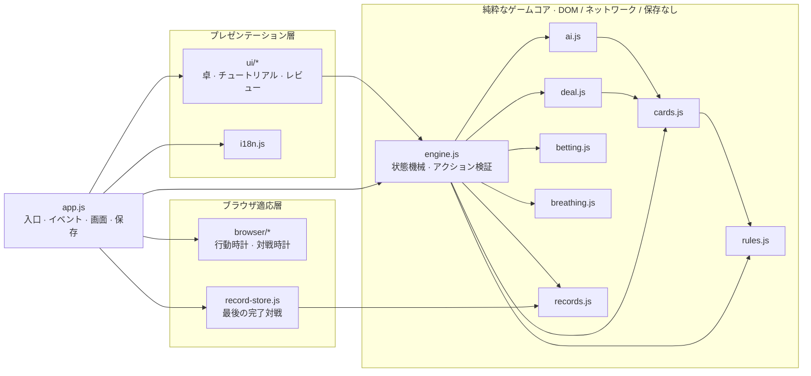

<p align="center">
  <a href="README.md">简体中文</a> · <a href="README.en.md">English</a> · <strong>日本語</strong>
</p>

<p align="center">
  
</p>

<h1 align="center">エア・ポーカー · Air Poker</h1>

<p align="center"><strong>賭けるのは、次のひと呼吸。</strong></p>

<p align="center">
  数字からの役作り · 隠された情報 · 空気を賭ける駆け引き<br>
  白い紙と黒いインク、動く漫画で描く1人用ブラウザ戦略ゲーム
</p>

<p align="center">
  <a href="https://wychmod.github.io/air-poker/"><strong>今すぐ遊ぶ →</strong></a> ·
  <a href="#基本ルール">基本ルール</a> ·
  <a href="#設計と技術的な見どころ">設計</a> ·
  <a href="#コントリビュート">コントリビュート</a>
</p>

<p align="center">
  <a href="https://github.com/wychmod/air-poker/actions/workflows/ci.yml"></a>
  <a href="https://github.com/wychmod/air-poker/actions/workflows/pages.yml"></a>
  
  
  <a href="LICENSE"></a>
</p>

---

## ゲーム紹介

**空気は、賭け金であり、生き残るための時間でもあります。**

プレイヤーと対戦相手は、それぞれ5枚の非公開の数字カードを持ちます。共有のトランプから役を作り、攻めるか退くか、次のラウンドに何を残すかを判断します。数字が指定するのは5枚のカードの合計値。勝負を決めるのはポーカーの役の強さ。そしてベットのたびに、これからの呼吸に使える空気の備蓄が変わります。5ラウンド後は耐久フェーズに移り、実際の給気と生存時間によって決着します。

ほとんどのポーカーは、ひとつのことだけを問いかけます。この役は十分に強いのか。

エア・ポーカーは、もうひとつ問いかけます。**残り時間は、あとどれだけあるのか。**

25缶のAIRは、卓上のチップであり、肺の中の空気でもあります。ポットを取っても、対戦に勝ったことにはなりません。

HTML・CSS・JavaScriptのみで実装され、対戦ロジックはすべてローカルのブラウザ上で動作します。アカウントやゲーム用バックエンドは不要です。**ゲーム画面は現在、中国語と英語に対応しています。このREADMEは中国語・英語・日本語の3言語で提供しています。**

## 画面

|                                                               ショーダウン                                                                |                                                             対戦レビュー                                                             |
| :---------------------------------------------------------------------------------------------------------------------------------------: | :----------------------------------------------------------------------------------------------------------------------------------: |
|  |  |
|                                                     公開カード、実際の投入額、AIR口座                                                     |                                             各ラウンドの事実、個別の移動、イベント時系列                                             |

画面は紙の白を地に、インクの黒を骨格とし、線画、網点、紙の質感、水中の明暗を保っています。数字、カード、操作、収支はすべて実際の状態から描画されます。サンプルデータ入りの完成画像を、操作可能な画面として見せることはありません。

## 基本ルール

| 要素               | 現在のルール                                                                                                                                                                                                    |
| ------------------ | --------------------------------------------------------------------------------------------------------------------------------------------------------------------------------------------------------------- |
| 初期リソース       | 双方に **25缶のAIR** を配布。開始時に1缶を呼吸用に開け、残り24缶をベットに使用できます。                                                                                                                        |
| 数字と役作り       | 毎ラウンド数字カードを1枚消費し、合計値がその数字になる **未使用の異なる実体カード5枚** を選びます。A=1、J/Q/K=11/12/13です。                                                                                   |
| 共有デッキ         | 同じ52枚のデッキの残りから、双方が独立して役を作ります。同一ラウンド内ではカードが重複する場合があります。有効な役のカードは公開の捨て札となり、以後は再使用できません。                                        |
| 交互のベット       | チェック、コール、レイズ、フォールド、ルール上可能なオールインを選択します。レイズはコール分を支払い、その後のポットの半額まで上乗せできます。2回連続のチェックでベットが終了します。                           |
| ショーダウンと災厄 | 通常の5枚ポーカーの役で比較します。双方の役が有効で、同一の実体カードが重複し、引き分けでない場合、敗者は追加で空気を失います。上限は、そのラウンドの自身の投入額と残りの未開封備蓄の少ない方です。             |
| リアルタイムの呼吸 | 1缶は約 **300秒** 給気し、空になると自動で交換します。開封済みの缶はベットできません。役作りは **60秒**、プレイヤーのベット行動は1回 **30秒** です。                                                            |
| 耐久フェーズと決着 | 5ラウンド終了、アンティを相互に支払えない場合などに耐久フェーズへ移ります。早送りも可能です。給気が尽きると **デジタル版独自の10秒の猶予** が始まり、先に猶予を使い切った側が敗北します。同時なら引き分けです。 |

**1ラウンドの流れ：** 数字を選ぶ → 5枚の役を作る → 確定してアンティを払う → 交互にベットする → 公開・精算する。

カードは1枚ずつ自由に選べるほか、最大3つのおすすめ候補を読み込んで編集できます。数字が大きいほど役が強いとは限りません。強い役でも、後のラウンドに必要なカードを使い切ったり、重複による災厄のリスクを負ったりします。

### 役作りの例

そのラウンドの数字が **17** なら、**A・2・3・4・7** を選べます。

```text
A + 2 + 3 + 4 + 7 = 17
```

合計値が正しいだけでは不十分です。実際の役は、異なる5枚の実在する未使用カードで構成され、さらにショーダウンで他の有効な役と比較されます。

役作りの放棄、時間切れ、無効な役の提出は構築失敗となり、実体カードは消費しません。誰もフォールドしていない場合、一方だけの失敗はポットの敗北、双方の失敗は同じラウンドのやり直しとなり、アンティやベットは繰り返しません。双方の数字が数学的に構築不可能なら、投入分を返却して耐久フェーズへ移ります。詳細は[現在のデジタル版ルール](doc/rules/current.md)をご覧ください。

## 特徴と見どころ

| 特徴                           | 体験できること                                                                                                                                   |
| ------------------------------ | ------------------------------------------------------------------------------------------------------------------------------------------------ |
| 白い紙、黒いインク、動くコマ   | 余白、線画、網点、グレースケールの水光が画面を統一。カードの提示、支払い、公開、災厄の演出は実際の対戦イベントに連動します。                     |
| ひとつの備蓄、ふたつの用途     | 未開封の空気はベットにも次の呼吸にも必要です。目先の役の強さと、長く生き残るための判断が結び付きます。                                           |
| 情報を制限された対戦相手       | 対戦相手はプレイヤーの選択前に自分の選択を確定し、自分の非公開情報、公開数字、捨て札、ベット履歴のみで判断します。                               |
| チュートリアルから振り返りまで | ホーム、紹介、独立したチュートリアル、対戦、勝利、敗北、引き分け、対戦レビューの8画面を用意しています。                                          |
| 追跡できる空気の収支           | 各ラウンドの数字、役作りの試行、イベントの時系列、個々の移動を確認し、JSONで出力できます。初期50缶の行き先を継続的に照合します。                 |
| 調整できる動き                 | 演出を無効にでき、OSの「視差効果を減らす」設定にも対応。設定画面からは、一時停止、シーク、元画像との比較ができる独立した動的漫画デモも開けます。 |

ローカルに保存するのは **最後に完了した1対戦のみ** です。次の対戦が完了すると置き換わります。ページを再読み込みしても、未完了の対戦は再開できません。演出の無効化、ルールや記録の閲覧、言語切り替え、バックグラウンドへの移行によって、呼吸や行動期限が停止・リセットされることはありません。

## 原作とインスピレーション

本プロジェクトは、**迫稔雄の漫画『嘘喰い』（Usogui / 噬谎者）第40〜43巻の「エア・ポーカー」編** をもとにした、非商用のファンによる学習プロジェクトです。数字からの役作り、限られた情報、空気を賭ける緊張感を、ブラウザで操作できる体験へと落とし込んでいます。

ビジュアルは「白い紙と黒いインクによる動く漫画」が軸です。コマ割り、線、水中の明暗で雰囲気を作り、カード、数字、操作は読み取りやすく前面に配置しています。

デジタル版では、原作の上層・下層の役割を1人のプレイヤーに統合しています。自動の缶交換、役作りの制限時間、固定の猶予、双方が構築不可能な場合の耐久フェーズへの移行などは、この版のために定めたルールです。出典と改編の範囲は[原作・ルール照合記録](doc/rules/audit.md)にまとめています。

## クイックスタート

**Node.js 22以降** とnpm、ES modulesに対応したモダンブラウザを用意してください。

```sh
git clone https://github.com/wychmod/air-poker.git
cd air-poker
npm ci
npm start
```

ブラウザで **[http://127.0.0.1:4173](http://127.0.0.1:4173)** を開きます。すでにリポジトリをダウンロード済みなら、プロジェクトのルートで `npm ci` と `npm start` を実行してください。ポートは環境変数 `AIR_POKER_PORT` で変更できます。

ES modulesを読み込むため、ローカルのHTTPサーバー経由でアクセスしてください。コードのコンパイル工程やサードパーティーのゲーム実行時パッケージはありません。ホーム画面のアクセスカウンターには外部の画像を使用しています。

### 初めて遊ぶとき

1. ホームの「How to play」で、数字、ベット、災厄の3つの概念を確認します。
2. 「Try the tutorial」で、対戦とは独立した練習を行います。
3. 「Enter the match」で対戦を開始し、数字を選択・確定してから、役作り、ベット、カード公開へ進みます。
4. 終了後のレビューで判断と空気の増減を確認し、必要に応じて記録を出力します。ホームの「Last completed match」から保存済みの結果を再表示できます。

## 設計と技術的な見どころ

ゲームコアはブラウザ環境から厳密に分離されています。`game/` はDOM、ネットワーク、ストレージ、タイマー、NodeプラットフォームAPIにアクセスしないため、ブラウザなしで読み込み、テストできます。画面は公開スナップショットのみを消費し、ブラウザ側のモジュールが時計、保存、描画スケジューリングを担当します。



`createGame()` は非公開の対戦状態を保持し、4つの入口だけを公開します。

- `getState()` は独立したスナップショットを返し、対戦相手の未出数字と公開前の役を隠します。
- `getRecord()` は必要に応じて完全な記録を返し、進行中は未公開の対戦相手の役を隠し続けます。
- `dispatch(action)` は現在のフェーズで合法なアクションだけを受け付けます。重複確定、不正なフェーズ、古いアクションは状態を変えず、二重に課金しません。
- `reset()` は新しい対戦を開始し、アクション番号は再開をまたいで増加します。

- **ルールは純粋関数で、状態の情報源はひとつ。** 役の比較、ベットの合法性、給気計算、収支記録はブラウザなしで動作し、テストは画面に依存しません。
- **プライバシーはデータ境界で守る。** `getState()` は対戦相手の未出数字、公開前の役、証明用の役を画面へ渡しません。表示層から「覗く」ことはできません。
- **アクションに身元を持たせ、時間切れは一度だけ発火。** `sessionId`、`attemptId`、`turnId` が再開、再構築、古いコールバックを分離し、重複確定と二重精算を防ぎます。
- **時間は絶対値で扱う。** バックグラウンド復帰、演出の停止、言語切り替えで実際の期限は延びません。1回の長い復帰と細かい段階実行は同じ状態になります。
- **空気の元帳は再生できる。** すべての移動に前後の5口座を記録し、合計は常に50です。記録担当は事実だけを残し、対戦相手の判断や精算には関与しません。
- **静的サイトでも構造を検査する。** アーキテクチャチェッカーは静的インポートを解析し、計算されたモジュールパスを拒否し、層の境界を強制します。公開は明示的な許可リストに従います。
- **表示と対戦を分離する。** Canvas演出は公開イベントだけを消費します。アニメーションの完了で課金や精算は起きません。非表示時は描画を止め、復帰時にエンジンと同期します。

状態遷移、依存マトリクス、プラットフォーム境界の全体は[アーキテクチャとルール境界](doc/harness/architecture.md)をご覧ください。

## 開発とデプロイ

| コマンド               | 用途                                                                                       |
| ---------------------- | ------------------------------------------------------------------------------------------ |
| `npm test`             | ゲームルール、エンジン、収支、開発用チェッカーの回帰テストを実行します。                   |
| `npm run check`        | 構文、アーキテクチャ、テスト、整形、ビルド、HTTPリソースを順に検証し、失敗時は停止します。 |
| `npm run format:check` | 管理対象のソースと技術文書の書式を確認します。                                             |
| `npm run format`       | 管理対象ファイルを整形します。実行後に差分を確認してください。                             |
| `npm run build`        | 明示的な公開対象リストから、静的サイトを `dist/site/` に生成します。                       |
| `npm run check:smoke`  | 生成済み成果物のローカルリソースとHTTP読み込みを検証します。先にbuildを実行してください。  |

デプロイ前に `npm run check` を実行し、生成された **`dist/site/`** を静的ホスティングに公開します。リポジトリには、公開前に同じ検証を行うGitHub Pagesワークフローがあります。テスト、開発依存関係、技術文書はサイト成果物に含まれません。

検証全体のレポートは `output/harness/latest.json` に出力されます。HTTPリソース検証はページのスクリプトを実行しません。操作の変更には、該当する[ブラウザ受け入れ確認](doc/harness/acceptance.md)も必要です。

### プロジェクト構成

| パス                  | 役割                                                                             |
| --------------------- | -------------------------------------------------------------------------------- |
| `game/`               | 役の比較、共有デッキ、配札、対戦相手の判断、ベット、呼吸、記録、唯一の状態機械。 |
| `browser/`            | 対戦・行動の時計、最後に完了した対戦の保存、シーン演出、アクセス集計。           |
| `ui/`                 | ページ、卓、自由な役作り、チュートリアル、記録、レビューの描画。                 |
| `app.js` / `i18n.js`  | アプリの入口、イベント、画面の調整 / 中国語・英語の文言。                        |
| `styles/` / `assets/` | スタイルとビジュアル素材。実行時リソースは明示したリストに従って公開します。     |
| `tests/` / `scripts/` | 回帰テスト、ローカルサーバー、書式検証、静的サイトの生成。                       |
| `doc/`                | 現在のルール、アーキテクチャ、受け入れ確認の証跡、過去の設計記録。               |

## コントリビュート

Issue、ルールの照合、テストの追加、画面の改善を歓迎します。

開始前に [AGENTS.md](AGENTS.md) と[開発・受け入れフロー](doc/harness/workflow.md)をお読みください。このプロジェクトはルール境界と状態の一貫性を重視するため、小さく明確な変更が適しています。

1. **範囲を確認する。** `git status --short --branch` を実行し、作業ツリーにある未コミットの変更を保持します。
2. **ルール変更にはテストを付ける。** 役、ベット、給気、精算、記録に関わる場合は、入力、アクション列、期待結果を先に記述し、回帰テストを追加します。
3. **アーキテクチャ検査を迂回しない。** ゲームコアはDOM、ネットワーク、ストレージ、プラットフォームのタイマーにアクセスできません。新しいモジュールには明確な責務と層の割り当てが必要です。
4. **提出前に全体を検証する。** `npm run check` を実行し、画面、タイマー、保存、イベント、ナビゲーションを変更した場合は、関連する[ブラウザ受け入れ確認](doc/harness/acceptance.md)も行います。
5. **レビュー可能なコミットを保つ。** 無関係な整形を混ぜず、`dist/`、テスト出力、ローカルのスクリーンショットキャッシュをコミットしません。
6. **結論だけでなく証拠を示す。** Pull Requestには、何を変えたか、なぜ変えたか、どの検査を実行したか、未検証の項目を書いてください。

不具合を報告するときは、ブラウザとバージョン、再現手順、期待結果、実際の結果を添えてください。ルールの議論では、記憶ではなく現在のルールまたは実行可能なテストを引用してください。

AI支援による開発は歓迎しますが、変更、テスト、事実の正確性については提出者が責任を負います。

## ドキュメント

- [ドキュメント索引](doc/README.md)：現在の実装、実施記録、過去の提案への入口です。
- [現在のルール](doc/rules/current.md) · [原作・改編の照合](doc/rules/audit.md)：ゲームの詳細と根拠を確認できます。
- [開発用Harness](doc/harness/README.md) · [開発フロー](doc/harness/workflow.md) · [共同作業の指針](AGENTS.md)：開発と受け入れ確認のガイドです。
- [8画面の実装記録](doc/harness/ui-v2-implementation.md) · [動的漫画デモ](doc/harness/motion-demo.md)：画面、演出、検証範囲をまとめています。
- [完全な記録と収支](doc/rules/records/spec.md) · [ホームのアクセス集計](doc/harness/visit-counter.md)：保存とJSON出力、公開HTTPSホームでの画像読み込み回数（PV）の集計について説明しています。ローカル開発は集計対象外です。

## コミュニティと謝辞

- 『嘘喰い』と「エア・ポーカー」編のルールの着想を与えてくださった迫稔雄氏に感謝します。
- ルールの照合、試遊、不具合の再現、テストの追加に参加してくださったすべての方に感謝します。
- ゲームはネイティブWebプラットフォームで構築されています。開発と納品にはNode.js、Prettier、Acorn、GitHub Actions、GitHub Pagesを利用しています。
- ビジュアル素材の出典と使用範囲は、[実行素材の説明](assets/generated/air-poker-v2/README.md)と[参考素材の説明](assets/reference/usogui-air-poker/README.md)に記載しています。

もう1戦遊びたくなったら、リポジトリにStarを付けていただけると嬉しいです。違和感を見つけたら、再現できる具体例付きでIssueを開いてください。

## ライセンス

コードは [MIT License](LICENSE) で公開されています。Copyright © 2026 tots-and。

MITライセンスは、本プロジェクトの作者が書いたコードに適用されます。『嘘喰い』、漫画画像、キャラクター、商標、その他の第三者素材は自動的に同ライセンスの対象にはならず、権利は各権利者に帰属します。

本プロジェクトは非公式・非商用のファンによる技術実験であり、原作者、出版社、その他の権利者との提携や許諾関係はありません。

---

<p align="center">
  <a href="README.md">简体中文</a> · <a href="README.en.md">English</a> · <strong>日本語</strong>
</p>
