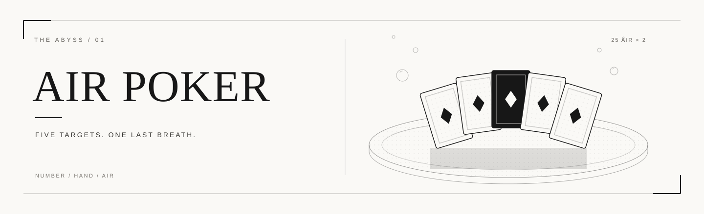
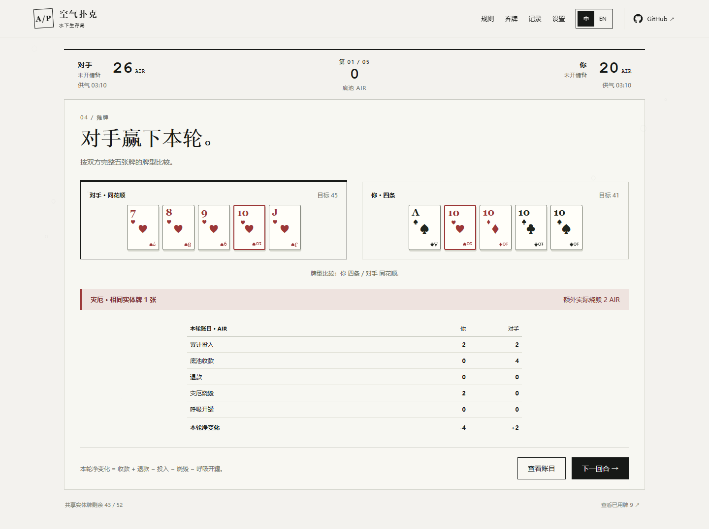
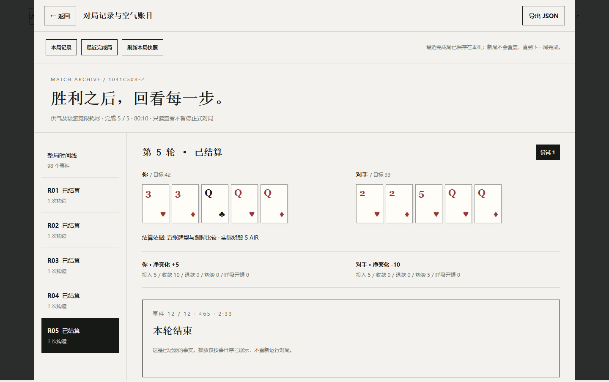
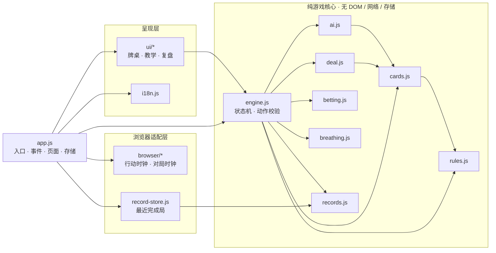

<p align="center">
  <strong>简体中文</strong> · <a href="README.en.md">English</a> · <a href="README.ja.md">日本語</a>
</p>

<p align="center">
  
</p>

<h1 align="center">空气扑克 · Air Poker</h1>

<p align="center"><strong>你下注的，是下一口空气。</strong></p>

<p align="center">
  数字构牌 · 隐藏信息 · 空气博弈<br>
  以白纸黑墨动态漫画呈现的单人浏览器策略游戏
</p>

<p align="center">
  <a href="https://wychmod.github.io/air-poker/"><strong>立即试玩 →</strong></a> ·
  <a href="#核心玩法">玩法</a> ·
  <a href="#架构与技术亮点">技术</a> ·
  <a href="#贡献">贡献</a>
</p>

<p align="center">
  <a href="https://github.com/wychmod/air-poker/actions/workflows/ci.yml"></a>
  <a href="https://github.com/wychmod/air-poker/actions/workflows/pages.yml"></a>
  
  
  <a href="LICENSE"></a>
</p>

---

## 游戏介绍

**空气既是筹码，也是生存时间。**

你与对手各持五张私有数字牌，围绕一副共享的扑克牌库构造成手。数字决定五张牌的目标和，牌型决定摊牌强弱，而每一次下注都会改变你剩余的呼吸储备。五轮之后，赌局转入耐息；最终胜负取决于实际供气与生存时间。

大多数扑克只问你：这手牌够不够大。空气扑克还问第二件事：**你还剩多少时间。**

25 罐 AIR 同时承担两种角色。它可以是下注的筹码，也可以是下一轮的呼吸。赢下底池，不代表已经赢下整局。

项目以原生 HTML、CSS 和 JavaScript 实现，对战逻辑全部在本地浏览器运行，无需账号或游戏后端。**游戏界面提供中文、英文；本 README 提供中文、英文、日文三个版本。**

## 界面

|                                                 牌桌摊牌                                                 |                                                完整复盘                                                |
| :------------------------------------------------------------------------------------------------------: | :----------------------------------------------------------------------------------------------------: |
|  |  |
|                                    公开牌面、真实投入与 AIR 账户变化                                     |                                     逐轮事实、逐笔账目与事件时间线                                     |

界面以纸白为底、墨黑为骨，保留线稿、网点、纸张肌理和水下明暗。数字、牌面、按钮与账目全部由真实状态渲染，不使用带示例数据的整页图片冒充可操作界面。

## 核心玩法

| 要素       | 当前规则                                                                                                                         |
| ---------- | -------------------------------------------------------------------------------------------------------------------------------- |
| 开局资源   | 双方各有 **25 罐 AIR**，各打开 1 罐供气，剩余 24 罐可用于下注。                                                                  |
| 数字与成手 | 每轮消耗一张数字牌，构造 **5 张不同、未使用的实体牌**，点数和必须等于该数字。A=1，J/Q/K=11/12/13。                               |
| 共享牌库   | 双方从同一副 52 张牌的剩余牌库独立构牌，同轮可以重叠；有效成手中的牌用后进入公共弃牌，后续不可复用。                             |
| 交替下注   | 选择过牌、跟注、加注、弃牌或合法全押。加注先跟齐，再增加至多跟齐后底池的一半；连续两次过牌结束下注。                             |
| 摊牌与灾厄 | 按标准五张扑克牌型比较。双方成手有效、存在实体牌重叠且分出胜负时，败者额外烧毁空气，上限为自身本轮投入与剩余未开储备的较小值。   |
| 实时呼吸   | 每罐近似供气 **300 秒**，用尽自动换罐；已开罐不能下注。构造时限 **60 秒**，每次玩家下注行动 **30 秒**。                          |
| 耐息终局   | 完成五轮或无法继续匹配底注等情况会进入耐息，可快进。供气耗尽后有 **10 秒数字版缺氧宽限**，单方先耗尽则另一方胜，同刻耗尽为平局。 |

**一轮的节奏：** 选择数字 → 构造五张牌 → 锁定并投入底注 → 交替下注 → 摊牌结算。

你可以逐张自由选牌，或填入至多三个推荐后继续编辑。数字大不等于牌型强；一手强牌也可能消耗后续需要的实体牌，或因重叠承担灾厄风险。

### 一个成手示例

本轮数字为 **17**，可以选择 **A、2、3、4、7**：

```text
A + 2 + 3 + 4 + 7 = 17
```

点数和正确只是第一步。实际成手还必须由 5 张不同、真实存在且尚未使用的实体牌组成，最后仍要与其他有效成手比较牌型。

主动放弃、超时或无效成手均记为构造失败，不消耗实体牌。无人弃牌时，单方失败会输掉底池；双方失败则同轮重做，不重复底注或下注。双方数字都数学无解时退回投入并转入耐息。完整判例见[当前数字版规则](doc/rules/current.md)。

## 特色与亮点

| 特色               | 体验                                                                                         |
| ------------------ | -------------------------------------------------------------------------------------------- |
| 白纸黑墨，动态分镜 | 留白、线稿、网点与灰阶水光构成统一视觉；出牌、支付、翻牌和灾厄反馈对应真实对局事件。         |
| 一份空气，两种用途 | 未开空气既是下注资源，也是后续供气储备，让眼前的牌力与长期生存相互牵制。                     |
| 信息受限的对手     | 对手在你选牌前锁定自己的选择，仅凭自身私有信息、公开数字、弃牌与下注历史决策。               |
| 从教学到复盘       | 八页界面涵盖首页、介绍、独立教学、对战、胜利、失败、平局与完整复盘。                         |
| 可核对的空气账目   | 查看逐轮目标、构造尝试、事件时间线与逐笔转移，并导出 JSON；账户持续核对总计 50 罐的去向。    |
| 可调节的动态表现   | 支持关闭动效并尊重系统减少动态效果偏好；设置中另有可暂停、拖动和对比原图的独立动态漫画示例。 |

本机仅保存**最近一个完成局**，下一局完成后才替换；刷新页面不会恢复未完成对局。关闭动效、查看规则或记录、切换语言以及切到后台，均不会暂停呼吸或重置行动时限。

## 来源与灵感

本项目改编自**迫稔雄漫画《噬谎者》（嘘喰い / Usogui）第 40–43 卷「空气扑克」篇**，作为非商用爱好者学习项目，尝试将数字构牌、受限信息与空气下注的紧张感转化为可交互的浏览器体验。

视觉沿用“白纸黑墨动态漫画”方向：以纸白为底，让分镜、线条与水下明暗承载气氛，把清晰的牌面、数字和操作留在前景。

数字版将原作上下层分工合并给单名玩家，并采用自动换罐、固定构造时限、固定缺氧宽限及双无解转耐息等明确约定。来源核对、规则差异与改编边界见[原作来源及规则核对](doc/rules/audit.md)。

## 快速开始

准备 **Node.js 22 或更新版本**及 npm，使用支持 ES modules 的现代浏览器。

```sh
git clone https://github.com/wychmod/air-poker.git
cd air-poker
npm ci
npm start
```

浏览器打开 **[http://127.0.0.1:4173](http://127.0.0.1:4173)**。如已下载仓库，在项目根目录执行 `npm ci` 和 `npm start` 即可。可通过 `AIR_POKER_PORT` 环境变量更改端口。

游戏通过 HTTP 加载 ES modules，请通过本地服务访问。项目没有代码编译步骤，也没有第三方游戏运行时包；首页访问统计使用远程计数图片。

### 第一次游玩

1. 在首页选择“了解玩法”，认识数字、下注与灾厄三个概念。
2. 选择“先练一次”，在独立教学中练习操作。
3. 选择“开始对局”，暂选并确认数字，再构造成手、下注与摊牌。
4. 结束后选择“查看复盘”，检查每轮选择、空气变化并按需导出；首页“最近完成局”可再次查看已保存结果。

## 架构与技术亮点

游戏核心与浏览器环境严格分离。`game/` 不访问 DOM、网络、存储、计时器或 Node 平台 API，因此可以在无浏览器环境中直接导入和测试；界面只消费公开快照，浏览器模块只负责时钟、归档和渲染调度。



`createGame()` 持有私有对局状态，只暴露四个入口：

- `getState()` 返回独立快照，隐藏对手未出数字与摊牌前成手。
- `getRecord()` 按需返回完整记录，进行中继续隐藏未揭示的对手成手。
- `dispatch(action)` 接受当前阶段的合法动作；重复确认、非法阶段和旧动作不会改变状态或重复扣款。
- `reset()` 开启新局，动作编号跨重开递增。

- **规则是纯函数，状态只有一个来源。** 牌型比较、下注合法性、供气计算和账本记录都可以脱离浏览器运行，测试不依赖页面。
- **隐私边界做在数据出口。** `getState()` 不会把对手未出数字、摊牌前成手或来源证明交给界面；表现层无法“猜牌”。
- **动作带身份，超时只生效一次。** `sessionId`、`attemptId` 和 `turnId` 隔离重开、重新构造与旧回调，防止重复确认和重复结算。
- **时间基于绝对时长。** 后台恢复、暂停动效或语言切换不会延长真实截止时间；一次长时间恢复与分步推进得到相同结果。
- **资金账目可连续重放。** 每笔空气转移保留前后五账户，守恒式始终为 50；记录器只记事实，不参与对手决策或结算。
- **静态站点也做结构约束。** 架构检查器解析静态导入、禁止计算模块路径，并按层级拒绝越界依赖；发布走显式白名单。
- **表现与对局解耦。** Canvas 动画只消费公开事件，动画完成不触发扣款或结算；隐藏页面时停止绘制，恢复后先同步引擎。

完整状态流、依赖矩阵和平台边界见[架构与规则边界](doc/harness/architecture.md)。

## 开发与部署

| 命令                   | 用途                                                                     |
| ---------------------- | ------------------------------------------------------------------------ |
| `npm test`             | 运行游戏规则、引擎、账目与工程检查器的回归测试。                         |
| `npm run check`        | 顺序执行语法、架构、测试、格式、构建与 HTTP 资源检查，任一步失败即停止。 |
| `npm run format:check` | 检查受管理源码与工程文档格式。                                           |
| `npm run format`       | 格式化受管理文件；运行后请检查差异。                                     |
| `npm run build`        | 按发布白名单生成静态站点 `dist/site/`。                                  |
| `npm run check:smoke`  | 检查已构建产物的本地资源与 HTTP 加载，需先执行 build。                   |

部署前运行 `npm run check`，将生成的 **`dist/site/`** 发布到静态托管服务。仓库提供 GitHub Pages 工作流，在发布前执行同一套检查；测试、开发依赖与工程文档不进入站点产物。

完整检查报告写入 `output/harness/latest.json`。HTTP 资源检查不执行页面脚本，交互改动仍需按[浏览器验收清单](doc/harness/acceptance.md)验证。

### 项目结构

| 路径                  | 职责                                                           |
| --------------------- | -------------------------------------------------------------- |
| `game/`               | 牌型、共享牌库、发牌、对手决策、下注、呼吸、记录与权威状态机。 |
| `browser/`            | 对局与行动时钟、最近完成局归档、场景动效与访问统计。           |
| `ui/`                 | 页面、牌桌、自由构牌、教学、记录与复盘渲染。                   |
| `app.js` / `i18n.js`  | 应用入口、事件与页面协调 / 中英文文案。                        |
| `styles/` / `assets/` | 样式与视觉素材；运行资源按显式清单发布。                       |
| `tests/` / `scripts/` | 回归测试、本地服务、格式检查与静态打包。                       |
| `doc/`                | 当前规则、架构、验收证据与历史设计记录。                       |

## 贡献

欢迎提交问题、规则核对、测试补充和界面改进。

开始之前，请先阅读 [AGENTS.md](AGENTS.md) 与[开发与交付流程](doc/harness/workflow.md)。这个项目对规则边界和状态一致性要求较高，改动最好小而明确。

1. **先确认范围。** 运行 `git status --short --branch`，保留工作区中已有的未提交修改。
2. **规则改动必须带测试。** 涉及牌型、下注、供气、结算或记录时，先描述输入、动作序列与期望结果，再补对应回归用例。
3. **不要绕过架构检查。** 游戏核心不得访问 DOM、网络、存储或平台计时器；新增模块需要明确职责并更新依赖矩阵。
4. **提交前跑完整校验。** 执行 `npm run check`；涉及界面、计时器、存储、事件或导航时，补做[浏览器验收](doc/harness/acceptance.md)的相关场景。
5. **保持提交可审阅。** 不混入无关格式化，不提交 `dist/`、测试输出或本地截图缓存。
6. **说明证据，而不只是结论。** Pull Request 请写清改了什么、为什么改、执行了哪些检查，以及尚未验证的部分。

反馈问题时，附上浏览器与版本、复现步骤、期望结果和实际结果。涉及规则争议时，请引用当前规则或可执行测试，而不是只凭印象。

本项目接受 AI 辅助开发，但提交者仍需对改动、测试和事实准确性负责。

## 文档

- [项目文档索引](doc/README.md)：当前实现、实施记录与历史提案的统一入口。
- [当前规则](doc/rules/current.md) · [来源与改编核对](doc/rules/audit.md)：玩法细节与依据。
- [工程 Harness](doc/harness/README.md) · [开发流程](doc/harness/workflow.md) · [协作约定](AGENTS.md)：开发与验收指南。
- [八页界面实施记录](doc/harness/ui-v2-implementation.md) · [动态漫画示例](doc/harness/motion-demo.md)：界面、动效与验证范围。
- [完整记录与账目](doc/rules/records/spec.md) · [首页访问统计](doc/harness/visit-counter.md)：归档与 JSON 导出；公网 HTTPS 首页统计图片加载次数（PV），本地开发不计入。

## 社区与致谢

- 感谢迫稔雄创作《噬谎者》，以及「空气扑克」篇提供的规则灵感。
- 感谢所有参与规则核对、试玩反馈、缺陷复现与测试补充的人。
- 游戏使用原生 Web 平台构建；开发与交付依赖 Node.js、Prettier、Acorn、GitHub Actions 与 GitHub Pages。
- 视觉素材的来源与使用范围记录在[运行素材说明](assets/generated/air-poker-v2/README.md)与[参考素材说明](assets/reference/usogui-air-poker/README.md)。

如果这个项目让你愿意多打一局，欢迎在仓库点一个 Star。发现问题也可以直接开 Issue；比起“感觉不对”，更希望看到能复现的具体场景。

## 许可证

代码以 [MIT License](LICENSE) 发布，Copyright © 2026 tots-and。

MIT 许可适用于本仓库中由项目作者编写的代码。原作《噬谎者》、漫画图像、角色、商标及其他第三方素材不自动包含在该许可中，相关权利归各自权利人所有。

本项目是非官方、非商用的爱好者技术实验，与原作者、出版社及相关权利方无隶属或授权关系。

---

<p align="center">
  <strong>简体中文</strong> · <a href="README.en.md">English</a> · <a href="README.ja.md">日本語</a>
</p>
