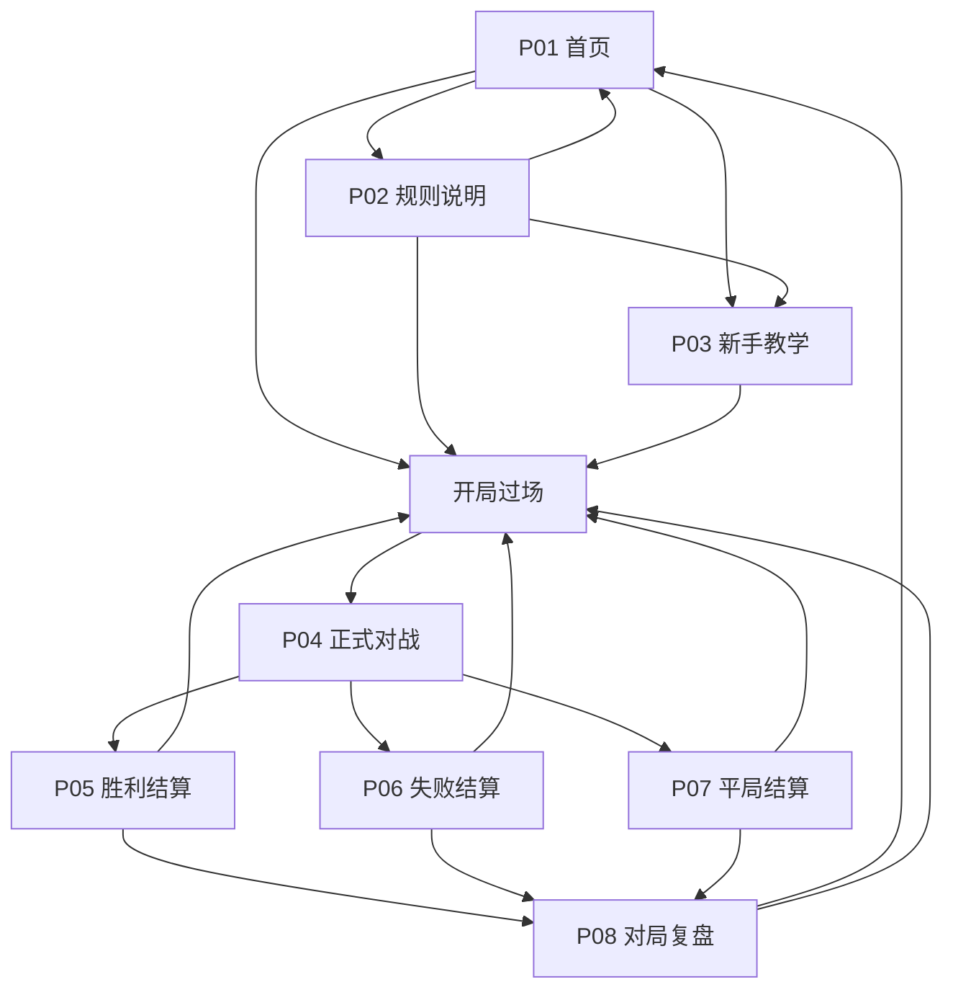

# AIR POKER 页面体系与交互设计方案

- 日期：2026-10-24
- 版本：页面设计 V2.0
- 适用：桌面与手机浏览器、单人对战、中文优先并支持英文
- 交付性质：产品与界面设计规格，供后续实现和验收使用；本文中的新增页面尚未接入游戏。

## 01. 结论：规划 8 个功能页面

建议规划 **8 个功能页面：6 个核心页面 + 2 个增强页面**。用户提出的首页、规则、胜利、失败均独立设计，同时补齐对战页和平局页，让游戏具备完整闭环。新手教学解决“看过规则仍不会玩”，对局复盘解决“玩完仍不懂为什么输赢”。

| 编号 | 页面                | 定位                                     | 交付优先级 | 当前基础                              |
| ---- | ------------------- | ---------------------------------------- | ---------- | ------------------------------------- |
| P01  | 首页 / 潜入前厅     | 建立氛围、开始对局、引导首次体验         | 核心       | 已有首页，可重组                      |
| P02  | 规则说明 / 空气协议 | 用实例讲清玩法，提供随时查阅入口         | 核心       | 已有档案页和规则弹窗，内容不完整      |
| P03  | 新手教学 / 训练潜舱 | 通过可操作练习完成一次小型学习闭环       | 增强       | 需要新增教学脚本与练习状态            |
| P04  | 正式对战 / 深海牌桌 | 完成目标选择、锁牌、下注、摊牌与回合结算 | 核心       | 已有主要阶段，需要改善信息层级        |
| P05  | 胜利结算 / 浮升     | 强调胜利，同时说明获胜依据               | 核心       | 当前 summary 的胜利分支，需独立呈现   |
| P06  | 失败结算 / 沉降     | 解释失利，提供有依据的重试入口           | 核心       | 当前 summary 的失败分支，需独立呈现   |
| P07  | 平局结算 / 静水     | 如实呈现平局及下一步                     | 核心       | 当前 summary 已能区分平局，视觉需独立 |
| P08  | 对局复盘 / 深海档案 | 逐轮查看成手、有效牌与空气账目           | 增强       | 需要新增完整回合记录与结果快照        |

这里的“页面”指有独立任务和布局的功能界面，**不等于创建 8 个 HTML 文件**。胜利、失败、平局共享同一结果数据与基础组件，通过三套构图和文案呈现。

另外设计 **1 个开局过场、5 个对战子状态、6 类浮层**，都不增加功能页面数量。

- 开局过场：准备牌桌，展示双方初始空气；不是需要用户导航的常驻页面。
- 对战子状态：选择目标、暂定成手、下注、摊牌比较、回合账目。
- 浮层：设置、局内规则、弃牌查看、回合记录、危险操作确认、错误恢复。

配套视觉蓝图：[打开 8 页设计预览](page-design-preview/index.html)。预览使用演示数据，展示页面布局、状态和跳转意图，不进行真实牌局计算。

## 02. 设计依据与玩法边界

### 2.1 当前可核实的实现

以 `game/engine.js`、`game/rules.js`、`game/cards.js` 和项目 README 为当前体验版的规则依据。早期设计文档包含更多未来玩法，不能直接当成当前界面承诺。

| 主题   | 当前实现                                                              | 本方案的页面表达                                       |
| ------ | --------------------------------------------------------------------- | ------------------------------------------------------ |
| 对局   | 单人对战，双方初始 25 AIR，最多 5 回合                              | 首页直接说明“单人 / 25 AIR / 最多五回合”               |
| 目标   | 每轮使用固定目标集，可选其中一个目标                                  | 不宣传随机发牌；不把五张目标牌画成整局消耗中的同一手牌 |
| 候选   | 每个目标提供三个候选成手                                              | 写“三个候选”，不写“全部可组成手牌”                     |
| 点数   | A=1，J=11，Q=12，K=13；五张所选牌求和匹配目标                         | 点数和与牌型高低分开解释                               |
| 牌型   | A 在常规牌型比较中按高牌；A2345 顺子为五高                            | 用两个示例解释 A 的双重作用                            |
| 用过牌 | 可选入候选，但失效；不参加牌型和灾厄                                  | 同时显示“所选 5 张 / 有效 N 张”                        |
| 底注   | 第 R 轮双方各投入 R AIR，受双方可匹配空气限制                         | 分别显示本轮底注、额外下注和总投入                     |
| 下注   | 玩家行动后对手匹配下注并立即结算；额外加注 1–4 AIR，受可匹配资源限制 | 称为体验版简化下注；不呈现虚假的 AI 再加注或概率       |
| 全押   | 按双方可匹配资源封顶，无边池                                          | 当对手空气更少时，按钮写“押至对手上限”并显示实际金额   |
| 超时   | 下注 30 秒，超时过牌                                                  | 常驻倒计时；最后 10 秒提示一次“超时将过牌”             |
| 呼吸   | 回合之间双方各扣 1 AIR                                                | 写“下一回合前呼吸 −1 AIR”，不写“每轮扣 R AIR”          |
| 平局   | 最终空气相同即平局                                                    | 平局页不额外判累计底池或开启加赛                       |
| 存储   | 当前只保存语言偏好                                                    | 不展示“继续对局”；最近战绩需先实现结果保存             |

### 2.2 本次页面设计新增的能力

以下都是待实现的设计要求：独立结果视图、逐项结算展示、目标暂选确认、教学模式、完整回合记录、最近一局结果、上下文规则帮助、设置与退出确认。它们不能仅靠改文案变成“已经存在”。

完整随机发牌、所有组合枚举、多个 AI 难度、多轮下注、联机、账号、排行榜、商店和付费系统不进入本轮页面体系。未来实现后再扩展入口，避免首页出现大量无法使用的功能。

## 03. 产品方向与体验目标

**核心表达：你下注的，是下一口空气。**

玩家应先理解“选择目标，锁定成手，用空气下注”，再逐步理解用过牌、牌型比较与灾厄。叙事氛围服务于判断，不遮挡操作和账目。

| 玩家                     | 首要问题                         | 页面回应                                 |
| ------------------------ | -------------------------------- | ---------------------------------------- |
| 第一次接触               | 我在做什么，点哪里开始？         | 首页一个主入口，规则快速读懂，教学可选   |
| 看过原作                 | 这里采用什么规则，哪些做了简化？ | 规则页提供“当前体验版”说明               |
| 熟悉扑克但不了解空气扑克 | 目标数字与胜负有什么关系？       | 目标点数与牌型强弱使用对照实例           |
| 已玩过一局               | 为什么输了，下一局该注意什么？   | 结算页给直接依据，复盘显示真实账目       |
| 手机玩家                 | 哪些信息必须一直看见？           | 空气、目标、有效牌、当前动作与倒计时常驻 |

设计验收目标：首次进入能明确找到开始入口；每个阶段有一句行动说明；每次空气变化能找到原因；任何结束路径都有正确结果；对局中的只读查看不修改牌局。上述是设计目标，不是已有可用性测试结论。

## 04. 导航与完整用户旅程



复盘还提供“返回本局结算”，保持该局原本的胜 / 负 / 平结果。局内规则、弃牌和记录以浮层打开，关闭后返回原阶段；不能跳去首页丢失正在进行的对局。

### 4.1 三条重点旅程

1. **首次体验**：首页 → 可选教学 → 开局 → 第一回合 → 理解空气账目 → 完成对局 → 查看结果。
2. **熟悉后重玩**：首页 → 直接开局 → 快速决策 → 结果页 → 再来一局。教学不重复强制出现。
3. **解释失败**：失败页 → 关键回合 → 看清有效牌、比较依据和灾厄账目 → 返回结算 / 再来一局。

### 4.2 返回与中断规则

- 首页、规则、教学之间可自由返回；离开教学只丢弃练习进度，不生成失败战绩。
- 正式局中返回首页、重开和浏览器后退涉及离开对局，先提示确认；取消后原牌局继续。
- 玩家主动退出记为“已放弃对局 / 未完成”，不冒充空气耗尽或正式失败结果。
- 页面刷新后，若未实现恢复能力，回首页并说明“进行中的对局未保存”；不显示假的继续按钮。
- 结果页与复盘页的只读切换不新开局、不扣空气、不重算上一局。

## 05. 统一视觉与组件语言

### 5.1 设计概念：深海审判档案

采用漫画编辑式构图：偏左的大标题、窄幅竖排章节号、斜切金属边、明确的明暗分区。首页讲“潜入”，胜利讲“浮升”，失败讲“沉降”，平局讲“悬停”；对战时收敛装饰，让空气、牌面和动作成为主角。

### 5.2 色彩

| Token  | 色值      | 用途                               |
| ------ | --------- | ---------------------------------- |
| abyss  | `#030914` | 主背景、深海暗部                   |
| ice    | `#60D8FF` | 主按钮、当前阶段、胜利方向         |
| oxygen | `#FFC857` | 空气数值、底池、重要账目、平局方向 |
| danger | `#FF477E` | 高风险、灾厄、失败强调             |
| paper  | `#E6EEF5` | 正文和扑克牌面                     |

补充中性色：面板 `#091B2B`，次级正文 `#A9BECF`。每页只让一种强调色占主导；胜利页不使用满屏红色，失败页不把全部正文染红。牌的红黑花色仍按扑克习惯；不能只依靠颜色表达失效或胜负。

### 5.3 字体与尺度

| 用途            | 字体                         | 桌面建议        | 手机建议           |
| --------------- | ---------------------------- | --------------- | ------------------ |
| 英文展示标题    | Barlow Condensed 800–900     | 72–144 px       | 48–80 px           |
| 中文标题        | Noto Sans SC 700–900         | 30–48 px        | 24–32 px           |
| 正文            | Noto Sans SC 400–500         | 16 px，行高 1.7 | 15–16 px，行高 1.7 |
| AIR、目标、时间 | IBM Plex Mono 500–600        | 24–48 px        | 22–36 px           |
| 标签与辅助说明  | IBM Plex Mono / Noto Sans SC | 12–14 px        | 至少 12 px         |

关键操作区不使用当前界面里过小的装饰性字号。中文按钮保留完整中文，英文作为低优先级辅助，避免手机上两种语言同时占满按钮。

### 5.4 布局

- 桌面参考 1440 × 900；页面最大内容宽度 1440 px，边距 40–64 px。首页与结果页采用约 7:5 的左右分镜。
- 对战页以中间牌桌为核心，两侧信息栏可折叠；不为装饰人物压缩操作区。
- 768–1199 px 收起右侧日志；小于 768 px 改为纵向，次级信息进抽屉。
- 手机基准 390 × 844，同时验收 320、360、430 px 宽度。底部动作区可吸底，但内容预留等高空间和安全区，不能挡住最后一个候选。
- 规则等长页面自然滚动；背景图不扩大页面高度，隐藏的场景容器不占位。

### 5.5 关键组件

| 组件               | 必须包含的状态或信息                                          |
| ------------------ | ------------------------------------------------------------- |
| AIR 仪表           | 当前值、变化量、变化原因；数值可超过初始 25，不能被进度条截断 |
| 金属目标牌         | 数字、暂选 / 公开状态、不可用原因；不出现扑克花色             |
| 实体扑克牌         | 点数、花色、唯一实体身份；失效时斜线 + “已用失效”文字         |
| 候选成手           | 五张所选牌、有效牌数量、实际牌型、点数和、暂选标识            |
| 下注控件           | 本次新增额、下注后总投入、下注后剩余空气、可匹配上限          |
| 回合账目           | 呼吸、下注、底池返还、灾厄四类变化可区分                      |
| 阶段条             | 选目标 → 锁成手 → 下注 → 摊牌 → 账目，文字标识当前阶段        |
| 主 / 次 / 危险按钮 | 默认、悬停、键盘聚焦、按下、提交中、禁用及原因                |

### 5.6 动效、图像与声音

- 首页允许低速水纹与局部气泡；正文背板保持稳定，不叠加高亮扫描线。
- 公开目标约 200 ms；锁牌约 240 ms；摊牌约 400 ms；空气变化约 350 ms。呈现动效不控制实际规则计算。
- 开局过场目标 800–1400 ms，重复游玩可跳过；准备未完成时显示真实准备状态，不能制造虚假加载百分比。
- 灾厄只做一次短促边框强调，不反复闪屏或强制震屏；系统减少动态效果时直接展示结果。
- 视觉资产不烘焙标题、卡牌数字、胜率、按钮或 HUD；正文和数据全部由界面渲染。现有带 UI 残影的图片应先清理或更换。
- 声音默认关闭或在第一次明确交互后征得偏好；只有音频实际接入后才出现音量设置。所有提示均有视觉替代。
- 正式素材采用原创深海场景和原创人物剪影；`assets/reference/` 延续其 README 中的参考用途。

## 06. P01 首页：潜入前厅

### 6.1 目标与首屏

让玩家知道这是什么、如何开始、去哪里学习。首页主文案为“你下注的，是下一口空气。”，事实条为“单人对战 / 初始 25 AIR / 最多五回合”。

```text
┌ AIR POKER ───────────────────── 规则  设置  中文/EN ┐
│  01 / THE DESCENT                               │
│                                                │
│  你下注的，                 [原创水下人物剪影]  │
│  是下一口空气。             [空气上升的留白]    │
│                                                │
│  公开目标。锁定五张。用空气承担每次选择。        │
│  [开始对局 →]  [新手教学]                       │
│  查看完整规则                                  │
│                                                │
│  25 AIR / 单人对战 / 最多 5 回合                 │
│  最近一局：胜利 29:13  [查看复盘]  （有数据时） │
└────────────────────────────────────────────────┘
```

### 6.2 内容与交互

- “开始对局”是唯一最强按钮，进入开局过场；不把首页变成模式选择表单。
- 新玩家在主按钮下看到一次轻提示“第一次潜入？先练一次锁牌与下注”；教学可跳过。
- 规则入口始终可见。未有完整结果记录时，最近一局区域整体不显示。
- 设置为图标配无障碍名称，打开设置浮层；语言选择当场生效，不重新发牌。
- 当前无真人联网功能，写“本地单人对局”，不用“实时连接”“在线人数”等暗示。
- 当前无进行中存档，不提供“继续对局”。未来有存档时才能替换首页主入口。

### 6.3 手机与边界

标题 → 简介 → 开始 / 教学 → 规则 → 事实条；人物背景移到标题右上，不压住按钮。首次渲染图片失败时仍显示标题与操作。主按钮提交中防重复；初始化失败留在首页，给“重试准备”，不进入空牌桌。

## 07. P02 规则说明：空气协议

### 7.1 目标与结构

先让玩家在一分钟内读懂最小规则，再允许深入查阅。页面分“快速开始”和“规则详解”，不是三张气氛插图配概念短句。

```text
┌ ← 返回首页                 空气协议              ┐
│  看懂下一口空气，如何输赢。                     │
│  [快速开始] [规则详解]   适用：当前体验版       │
├─────────────┬──────────────────────────────────┤
│ 01 回合流程 │ [1 选目标] → [2 锁成手] →        │
│ 02 数字与牌 │ [3 下注]   → [4 摊牌与账目]     │
│ 03 下注     │                                  │
│ 04 用过牌   │ 目标 24 ≠ 战斗力 24              │
│ 05 灾厄     │ 4♠ + 4♥ + 4♦ + 5♣ + 7♠ = 24    │
│ 06 胜负     │ 牌型：三条                       │
├─────────────┴──────────────────────────────────┤
│ [开始新手教学]              [直接开始对局 →]  │
└────────────────────────────────────────────────┘
```

### 7.2 六个章节的必讲内容

| 章节              | 内容                                                                 | 必须出现的例子                         |
| ----------------- | -------------------------------------------------------------------- | -------------------------------------- |
| 01 一回合怎么进行 | 目标公开 → 私下锁牌 → 下注 → 摊牌 → 账目                             | 明确成手在下注前冻结                   |
| 02 数字与牌型     | 目标只是五张牌点数和；牌型决定大小                                   | 目标 24 的三条可能胜过更高目标的高牌   |
| 03 空气与下注     | 初始 25；底注按回合；额外下注；匹配上限；回合间呼吸                  | 第 2 回合底注 2 + 新增 2 = 总投入 4    |
| 04 用过牌失效     | 五张所选牌仍参与目标求和，只有有效牌参与牌型                         | 所选 5 张，有效 3 张，按三张有效牌比较 |
| 05 灾厄           | 双方有效成手有同一实体牌，非平局败者额外失去自己的下注额，最多扣到 0 | 展示下方的 25 → 19 AIR 示例            |
| 06 如何结束       | 空气耗尽、回合间呼吸耗尽、五回合结束比较空气、空气相同平局           | 五回合后 29:13 获胜，21:21 平局        |

牌型强弱：高牌 < 一对 < 两对 < 三条 < 顺子 < 同花 < 葫芦 < 四条 < 同花顺。皇家同花顺是 A 高同花顺的名称；A2345 是五高顺子，不是皇家。有效牌不足五张时不能形成顺子、同花或葫芦等要求五张牌的组合；四条、三条、两对、一对按有效牌数判定，零张有效最弱。

### 7.3 用一张账单讲清灾厄

示例双方开始均为 25 AIR，本回合底注与追加合计各投入 3 AIR，玩家输牌且触发灾厄：

| 项目         | 你     | 对手    |
| ------------ | ------ | ------ |
| 回合开始     | 25     | 25     |
| 投入底池     | −3     | −3     |
| 底池发给胜者 | 0      | +6     |
| 灾厄额外扣除 | −3     | 0      |
| 本轮结算后   | **19** | **28** |

玩家净损失 6，对手净增加 3，另外 3 AIR 消失。不能写成“败者再赔整个底池”或“底池 × 2”；也不能把胜者收到的 6 全部称为净赚。示例不包含下一回合呼吸成本。

### 7.4 搜索、返回与手机

章节目录可跳转，例子就地展开；提供“数字越大越强吗”“为什么少了有效牌”“超时会怎样”等常见问题。首版无需引入站内搜索。

手机目录变为顶部分段导航和折叠章节。底部开始按钮不挡正文。由局内打开时使用 M02 快速规则浮层；若需要完整阅读，显示“返回本局”并保留来源，下注倒计时规则不变。

## 08. P03 新手教学：训练潜舱

### 8.1 定位

三项短练习，一次只要求做一个动作。练习使用独立、可重置的固定演示数据，不写入正式对局、不统计胜负、不启动 30 秒计时。

```text
┌ ← 离开教学        训练潜舱                  1 / 3 ┐
│ 先理解目标，再判断牌型。                         │
│ 目标 24                                         │
│ [4♠] [4♥] [4♦] [5♣] [7♠]                       │
│  点数和 24 / 有效 5 张 / 三条                    │
│ ┌ 教练提示：数字相同，也可以形成不同强度。 ┐    │
│ [重新练习]                  [确认这手牌 →]      │
└─────────────────────────────────────────────────┘
```

| 练习           | 操作                                     | 正确反馈                           | 错误反馈                             |
| -------------- | ---------------------------------------- | ---------------------------------- | ------------------------------------ |
| 1 目标与锁牌   | 在符合 24 的候选中暂选，再确认锁定       | 高亮和式，说明“现在仍未下注”       | 点数和不匹配时原地解释，不扣练习空气 |
| 2 空气账目     | 底注 1，额外下注 2，再看双方匹配与摊牌   | 将底注 1 + 新增 2 = 总投入 3 拆开  | 不把“加到 2”和“增加 2”混用           |
| 3 用过牌与灾厄 | 切换一个含失效牌的例子，再查看有效牌重叠 | 同实体重叠用连线高亮，逐行展开账单 | 点数相同但不同花色不算同一实体牌     |

完成页仍属于 P03，显示“你已掌握：目标、锁牌、空气账目”，主按钮“开始正式对局”，次按钮“再练一次”。不伪造等级、奖励或胜率。中途离开出现轻确认；再次进入可从第一练习开始。

手机采用上下结构，提示贴近当前可操作对象，不用遮住卡牌的大面积聚光层。每项练习都有文字说明，不能只靠闪动箭头。

## 09. P04 对战：深海牌桌

### 9.1 统一骨架

```text
┌ AIR POKER     R03 / 05     选目标 锁成手 下注 摊牌 账目 ┐
│ 你 24 AIR       底池 00       对手 22 AIR   规则 设置 退出 │
├───────────┬─────────────────────────────┬───────────────┤
│ 回合轨迹  │ 对手 / 目标 ? / 成手隐藏     │ 最近事件      │
│ R1 赢     │                             │               │
│ R2 输     │ 当前阶段一句话任务          │ [完整记录]    │
│ R3 当前   │                             │               │
│           │ [阶段主体：目标 / 手牌等]   │ 弃牌 16       │
│           │                             │ [查看弃牌]    │
│           │ 你 / 目标 ? / 有效牌 N 张   │               │
├───────────┴─────────────────────────────┴───────────────┤
│ 风险 / 费用预览                     [当前阶段主操作]  │
└───────────────────────────────────────────────────────┘
```

阶段主体变化，双方 AIR、轮次、阶段条和必要动作保持位置稳定。不要每次选择候选都重播整屏入场或跳动主按钮。

### 9.2 G01 选择目标

- 标题“先决定这手牌要凑多少点”；辅助“目标值不代表牌型强弱”。
- 显示本轮五张金属目标牌；点击只暂选，高亮唯一对象；主按钮“公开目标 24”。
- 点击主按钮才调用正式选择动作；公开后不能返回修改。暂选是界面状态，不提前修改游戏状态。
- 确认后同时显示双方目标，并说明“对手已私下锁定成手”。
- 当前候选模板均受控生成，不显示未经计算的“胜率”“可组出 N 万种”；将来有真实求解器后再加可解性信息。
- 无目标或候选异常时停在本阶段，提示重新准备；不扣底注、不让玩家进入空选牌页。

### 9.3 G02 暂定与锁定成手

- 三个候选完整呈现五张牌；每项显示目标点数和、有效张数、实际牌型。
- 每张用过牌同时具备斜线、降低饱和与“已用失效”提示；有效牌不被整手一起置灰。
- 默认可暂选系统排序的第一项，但必须标明“系统推荐 · 尚未锁定”，不自动进入下注。
- 候选使用“暂选”描述，只有确认按钮执行后才标“已锁定”；避免当前暂选样式写 LOCKED 的混淆。
- 推荐按有效牌型比较，不宣称已计算对手策略或获胜概率。显示“按有效牌型推荐”。
- 主按钮“锁定并进入下注”；附近说明“本轮双方各投入底注 3 AIR，锁定后不可换牌”。金额不足时显示实际匹配底注。
- 五张所选牌的点数和可能仍正确，但有效张数不足五张；不要错误阻止这种规则允许的选择。

### 9.4 G03 下注：最需要克制的页面

```text
┌ 已锁定 / 三条 / 有效 5 张 ───────── 00:24 ┐
│ [4♠][4♥][4♦][5♣][7♠]                     │
│                                          │
│ 当前底池 2 AIR      你已投入 1 AIR        │
│ 新增下注  [−]  2 AIR  [+]                 │
│ 下注后：总投入 3 AIR / 剩余 22 AIR        │
│ [过牌]             [增加 2 AIR →]         │
│ [弃牌]             [全押：24 AIR]         │
│ 超时将过牌；对手成手仍然隐藏。            │
└──────────────────────────────────────────┘
```

- 下注阶段只公开玩家已锁定成手，对手依然牌背；不可因 hover、日志或辅助读屏泄露对手成手。
- 数额控制采用步进器或数字输入，当前范围是 `1..min(4, 双方可匹配剩余空气)`；范围为空时禁用加注。
- “增加 2 AIR”表示本次新增；本轮总投入独立显示，不能把底注算两次。
- 当前简化流程没有真实待跟注差额，因此默认隐藏跟注按钮，保留过牌 / 加注 / 弃牌 / 全押。未来引擎支持跟注压力时由可用动作数据决定显示。
- 本版允许主动弃牌，含义是放弃本轮和已投入空气，不代表放弃整局。点击打开确认浮层，明确预计损失与可能灾厄。
- 当玩家有 10 AIR、对手只有 6 AIR 时，极限按钮写“押至对手上限 6 AIR”，预览剩余 4；不声称把 10 全部花掉。
- 最后 10 秒提高时间对比度，提示一次；不通过持续闪动制造不可读界面。
- 确认弃牌 / 全押期间，计时继续；若超时已处理，确认按钮必须失效并显示“本轮已自动过牌”，不能随后再次提交。
- 决策执行后立即锁住本轮动作，对手自动匹配后进入摊牌；不制造假的多轮思考和反加注。

### 9.5 G04 摊牌与比较

先显示两边牌面，再解释比较依据：牌型优先，同牌型再比较点数与踢脚。不要只给“YOU WIN”。

显示顺序：双方选中牌 → 有效牌识别 → 牌型名称 → 同牌型比较点 → 有效实体重叠。所有比较使用本轮开始时的弃牌快照，不能将刚进入弃牌区的本轮有效牌重新判为失效。

玩家弃牌时自己的成手盖回，标记“主动弃牌”；按现有体验版展示对手成手，不把“弃牌后隐藏对手”当作无声的规则修改。复盘允许玩家查看自己已选的牌。

提供“直接看账目”，可跳过呈现动效。减少动态效果模式直接显示完整比较结果。输赢判定先由引擎提交，动画不会重复执行结算。

### 9.6 G05 回合账目

在同一对战页内展开账目面板，不跳到独立“胜利页”。**赢一个回合不等于赢整局**。

| 展示项          | 说明                                 |
| --------------- | ------------------------------------ |
| 本轮开始空气    | 进入本轮、已处理上一轮间呼吸后的数值 |
| 你的总投入      | 底注 + 本轮新增下注                  |
| 底池返还 / 获得 | 收到多少，其中包含自己投入的返还     |
| 灾厄额外损失    | 实际扣除值，最多扣到 0；与理论额分开 |
| 本轮净变化      | 本轮结束空气 − 本轮开始空气          |
| 结算后空气      | 双方最终余额，明确下一步是否还能继续 |

下一轮可以开始时，主按钮“下一回合”，附近写“进入前双方各呼吸 −1 AIR”。该笔呼吸在点击推进后才计入；打开账目、规则或弃牌不扣费。若呼吸将耗尽空气，按钮改为“结算对局”，说明原因，不让玩家看到空的下一轮。

已结束时主按钮“查看最终结算”，进入 P05 / P06 / P07；不直接自动重开。

### 9.7 手机布局

1. 顶部紧凑固定区：轮次、双方 AIR、当前阶段；至少保留 44 px 可点区域。
2. 中部内容：对手简要状态 → 当前阶段 → 玩家成手；无装饰性大空白。
3. 底部动作区：阶段主按钮和关键费用。下注时倒计时与金额不可被浮层入口遮住。
4. 记录与弃牌由按钮打开抽屉；不能因隐藏侧栏就失去信息。
5. 优先完整纵向展示三个候选；若设计采用内部滚动，必须有剩余条目提示，不能让第三项看起来不存在。

## 10. P05 胜利结算：浮升

### 10.1 情绪与首屏

胜利具有光照上浮的方向感，用冰青、纸白与少量金色。大字展示“你赢下了这场对局”，而不是在任何胜利条件下都写“对手窒息”。

```text
┌ AIR POKER / MATCH CLOSED ──────────────────────┐
│  SURVIVED                         [上升光束]   │
│  你把最后的优势，留在了自己这一侧。            │
│                                               │
│  你 29 AIR     :     对手 13 AIR                │
│  判定：五回合结束，你的空气更多。              │
│                                               │
│  赢得回合 3/5  /  灾厄损失 0 AIR              │
│  关键回合 R5：本轮净获得 7 AIR                 │
│  [再来一局 →]   [查看对局复盘]                 │
│  返回首页                                     │
└───────────────────────────────────────────────┘
```

### 10.2 信息与交互

- 先展示胜负、双方最终空气和判定原因；统计放在后面，不喧宾夺主。
- 关键回合依据真实记录选择：先找改变领先关系的回合；没有时找本轮净变化绝对值最大的回合。不凭空评价“完美诈唬”。
- 主按钮“再来一局”，次按钮“查看对局复盘”；回首页为低优先级文字按钮。
- “再来一局”开始全新对局；不把结果记录清空后才让用户有机会查看。
- 没有完整复盘数据时不展示无法工作的复盘按钮，显示已有的简要结果。
- 手机先看结果与 AIR，再看操作，再向下看统计；主要按钮出现在可达区域。

### 10.3 获胜原因文案

| 原因               | 说明                                   |
| ------------------ | -------------------------------------- |
| 五回合空气领先     | 五回合结束，你剩余的 AIR 更多。        |
| 对手结算后空气归零 | 对手空气耗尽，你仍保有空气。           |
| 下一轮呼吸耗尽对手 | 对手未能承担下一次呼吸成本，对局结束。 |

本方案中的 29:13 是设计示例，不是固定奖励或游戏必然结果。

## 11. P06 失败结算：沉降

### 11.1 情绪与首屏

以向下消失的气泡、压低的光源、警戒红侧边形成失败感；保持主行动清楚可读。不要大面积闪红，也不嘲讽玩家。

```text
┌ AIR POKER / MATCH CLOSED ──────────────────────┐
│  DEFEAT                         [沉降剪影]     │
│  这一局，空气留在了对手那边。                  │
│                                               │
│  你 13 AIR     :     对手 29 AIR                │
│  判定：五回合结束，对手的空气更多。            │
│                                               │
│  关键回合 R5：本轮净损失 7 AIR                 │
│  [查看失利回合]                               │
│  [再来一局 →]   [完整复盘]                     │
│  返回首页                                     │
└───────────────────────────────────────────────┘
```

### 11.2 让失败可以理解

- 仍有空气但总量落后：标题“本局失利”，不能写“你的空气耗尽”。
- 余额为 0：才使用“空气耗尽”；分清是下注与灾厄，还是回合间呼吸导致。
- 同时显示输牌原因与额外损失：例如“有效牌只有 3 张，按高牌判定；本轮另因实体重叠损失 2 AIR”。只有记录确实支持时才展示。
- “查看失利回合”直接进入 P08 对应回合。默认高亮可核查事件，不自动生成无法证明的策略诊断。
- 没有分析数据时只呈现事实，不用通用鸡汤假装个性化建议。
- 再来一局与复盘都易于点击，不能让失败用户只能重试而找不到解释。

手机的主操作仍用可读的冰青按钮；红色用于结果与损失，不让“再来一局”看起来像第二个危险动作。

## 12. P07 平局结算：静水

### 12.1 为什么独立设计

当前体验版最终 AIR 相同即平局。如果只做胜利与失败，平局容易被错误地套用失败配色或 DROWNED 文案。独立的平局表达可以复用结果组件，但必须有自己的语义。

```text
┌ AIR POKER / STILL WATER ───────────────────────┐
│  DRAW                                         │
│  水面没有偏向任何一边。                       │
│  你 21 AIR     =     对手 21 AIR                │
│  双方最终空气相同，本局判定为平局。            │
│  [再较量一局 →]   [查看对局复盘]               │
│  返回首页                                     │
└───────────────────────────────────────────────┘
```

色彩以琥珀与纸白为主，两侧空气尺保持同长；不显示胜者徽章、不写失败、不按赢得回合数擅自决胜。也不展示当前未实现的加赛按钮。

若双方因同一次回合间呼吸同时耗尽，说明“双方空气同时耗尽，按当前规则判平”，不要使用五回合结束文案。教学中的练习平局留在教学，不生成正式 P07 记录。

## 13. P08 对局复盘：深海档案

### 13.1 目标与布局

解释“发生了什么”，提供事实账目。复盘不重新运行 AI，不根据当前牌库重新计算过去。

```text
┌ ← 返回本局结算        本局胜利 29 : 13          ┐
│  AIR 走势：你 ──╮─╭──╮──╭    对手 ─╯─╰──╯──╰ │
├─────────┬─────────────────────────────────────┤
│ R1 赢   │ R5 / 最终回合                       │
│ R2 输   │ 目标与双方所选牌                    │
│ R3 赢   │ 已用失效标记 / 有效牌型 / 比较依据  │
│ R4 输   │                                     │
│ R5 赢 ◀ │ 行动：底注 5 → 追加 2 → 对手匹配    │
│         │ 账目：开始 22 → 投入 −7 → 收回 +14  │
│         │ 结束 29 / 本轮净 +7 AIR             │
├─────────┴─────────────────────────────────────┤
│ [上一回合] [下一回合]  [返回结算] [再来一局]  │
└───────────────────────────────────────────────┘
```

### 13.2 复盘必须保存和展示的事实

- 对局结果、结束原因、规则版本、实际完成回合数。
- 每轮开始 AIR、目标、双方所选牌、原有弃牌、有效牌与失效原因。
- 锁定时机、底注、本轮每项行动与实际投入；超时动作标记“系统过牌”。
- 比较后的真实牌型与关键比较点；实际重叠实体牌。
- 正常返还、灾厄实际损失、回合结束 AIR、下一轮前呼吸。
- 完整时间序列的 AIR 图，以步骤或回合为横轴，不能用日志编号伪装实际秒数。

图表同时提供表格；数据点可点选回合。回合列表使用“赢 / 输 / 平 / 弃牌”文字，不只用红绿圆点。手机将回合列表改为横向标签，详情纵向展开。

### 13.3 样例账目校验

以下仅是图表和账单设计用的一致性示例，说明各项如何相加，不声称由当前固定候选自动产生。

| 回合 | 开始：你 / 对手 | 各自总投入 | 胜者 | 灾厄实际损失 | 结算：你 / 对手 | 随后呼吸 |
| ---- | -------------- | ---------- | ---- | ------------ | -------------- | -------- |
| R1   | 25 / 25        | 3          | 你   | 0            | 28 / 22        | 双方 −1  |
| R2   | 27 / 21        | 2          | 对手  | 0            | 25 / 23        | 双方 −1  |
| R3   | 24 / 22        | 4          | 你   | 0            | 28 / 18        | 双方 −1  |
| R4   | 27 / 17        | 4          | 对手  | 0            | 23 / 21        | 双方 −1  |
| R5   | 22 / 20        | 7          | 你   | 0            | 29 / 13        | 无       |

最终总空气为 42，等于初始 50 减四次双方呼吸共 8。胜方本局 AIR 净变化为 +4，不是本局所有收到的底池之和。

### 13.4 记录与空状态

首版仅保存最近一局完整结果。保存失败不影响当前结果，提示“本次记录未能保存，离开后可能无法再查看”；内存中的结果仍可复盘。

直接进入复盘但没有数据：展示“还没有可复盘的对局”，提供“开始对局”和“返回首页”。旧版本记录无法解释时展示简要结果与“不支持详细复盘”，不把旧记录当成新规则重算。

完整记录只有在对局结束后用于跨页面查看；局内“回合记录”只包含已发生的信息，不能通过复盘组件提前揭示未来或对手暗牌。

## 14. 六类浮层与全局状态

| 编号 | 浮层         | 内容                                       | 关闭行为                                   | 下注计时                                       |
| ---- | ------------ | ------------------------------------------ | ------------------------------------------ | ---------------------------------------------- |
| M01  | 设置         | 语言、减少动态效果、可用后才显示的音效偏好 | 保存偏好，回原界面；不重新开局             | 继续                                           |
| M02  | 局内规则     | 当前阶段要点、用过牌、牌型速查、灾厄例子   | 返回原阶段与原选择                         | 继续，浮层内也显示剩余秒数                     |
| M03  | 弃牌查看     | 已用实体牌、按花色 / 点数查看、已用数量    | 只读，不移动卡牌                           | 继续                                           |
| M04  | 回合记录     | 已完成回合及当前公开事件                   | 只读，不产生下一阶段动作                   | 继续                                           |
| M05  | 危险操作确认 | 弃牌、极限下注、重开、离开                 | 取消为默认安全项；确认前验证当前阶段仍有效 | 继续，超时后禁用旧确认                         |
| M06  | 错误恢复     | 出错阶段、是否保留有效状态、重试 / 重开    | 不静默丢失已完成结果                       | 能保留合法待决策状态时暂停；恢复后给完整 30 秒 |

M06 属于程序错误恢复，不是玩家可以随时调用的“无限暂停”。错误导致的等待不消耗玩家决策时间；如果已完成结算则保留结果，不重跑本轮。错误恢复失败时给重开和返回首页，并保留可用的上局结果。

### 14.1 确认文案

| 场景     | 标题与说明                                               | 主 / 次按钮         |
| -------- | -------------------------------------------------------- | ------------------- |
| 弃牌     | 放弃本回合？你已投入 3 AIR；弃牌仍可能承担灾厄额外损失。 | 确认弃牌 / 继续决策 |
| 极限下注 | 投入 6 AIR？本次按对手上限匹配，操作后剩余 4 AIR。       | 确认投入 / 返回调整 |
| 重开     | 重新开始？当前未完成对局将结束，不记为正式胜负。         | 确认重开 / 继续本局 |
| 离开     | 返回首页？进行中的对局尚未保存。                         | 确认离开 / 继续本局 |

确认浮层不能凭打开时的旧数字提交。超时、阶段切换或余额变化后，重新校验并刷新内容。

### 14.2 其他异常状态

- 图片和字体失败：使用纯色、可用字体和正文保持可玩，不让主按钮消失。
- 没有候选：停留在目标阶段并说明重新准备，不自动以高牌判负。
- 全部所选牌失效：仍可按规则锁定，但显著提示“有效 0 张，本轮成手最弱”。
- 底注耗尽可匹配余额：显示实际底注金额；禁用新增下注，仍可合法进入结算。
- 重复点击：按钮及时进入提交中，同一阶段只接受一次确认。
- 页面隐藏 / 后台：正常下注按经过时间计时，返回时立即显示真实剩余时间；过期按规则只处理一次。
- 浏览器存储不可用：仍可玩本局和切换语言；不承诺跨刷新保存。
- 状态与界面冲突：以引擎状态重新渲染，不能仅靠隐藏按钮维护合法性。

## 15. 文案与信息表达规范

### 15.1 统一术语

| 使用       | 含义                       | 避免                       |
| ---------- | -------------------------- | -------------------------- |
| 目标值     | 五张所选牌的点数和         | 战斗力、牌力值             |
| 暂选成手   | 尚可修改的选择             | 已锁定，除非真的完成锁定   |
| 有效牌     | 未因已经使用而失效的实体牌 | 把整手所选五张都称作有效牌 |
| 新增下注   | 这次再投入的 AIR           | 含糊的“加到 / 加了”        |
| 总投入     | 本轮底注与所有新增额之和   | 再把底注重复列入扣款       |
| 本轮净变化 | 本轮结束与开始余额之差     | 把收到的整个底池称为净赚   |
| 回合获胜   | 一轮结果                   | 在 R1 就显示整局胜利       |
| 对局胜利   | 整局结束的最终结果         | 和回合结果混用             |

### 15.2 关键短文案

| 位置       | 中文                                   | 英文方向                              |
| ---------- | -------------------------------------- | ------------------------------------- |
| 首页主标题 | 你下注的，是下一口空气。               | Your next breath is on the table.     |
| 首页开始   | 开始对局                               | Enter the table                       |
| 教学入口   | 先练一局                               | Learn the rules                       |
| 目标阶段   | 数字决定要凑多少点，牌型决定谁赢。     | Match the sum. Win with the hand.     |
| 锁定提示   | 锁定后，本回合不能更换成手。           | Your hand freezes before betting.     |
| 用过牌     | 已用失效 · 不参与牌型与灾厄            | Used · excluded from rank and overlap |
| 超时提示   | 剩余 10 秒，超时将过牌。               | 10 seconds left. Timeout checks.      |
| 普通赢牌   | 本轮获胜 · 净获得 3 AIR                | Round won · net +3 AIR                |
| 灾厄       | 实体牌重叠，败者额外失去自己的下注额。 | Overlap burns the losing stake again. |
| 胜利标题   | 你赢下了这场对局。                     | You survived the table.               |
| 失败标题   | 这一局，空气留在了对手那边。           | The observer takes this match.        |
| 平局标题   | 水面没有偏向任何一边。                 | The water chose no side.              |
| 复盘空状态 | 还没有可复盘的对局。                   | No match to review yet.               |

展示语言只切换文字与格式，不改变目标、手牌、排序、倒计时和 AI 决定。所有基于牌型的日志保存语义 key，在阅读时翻译，避免同屏两种语言混杂。

## 16. 无障碍、手机与输入规范

- 正文常规文本对比度目标至少 4.5:1，大字至少 3:1；逐一验收实际叠图后的颜色，不能只检查色板。
- 键盘可完成开始、选牌、确认、下注、查看规则和返回；焦点顺序遵循阅读顺序。
- 目标牌与候选使用单选语义，读屏能知道暂选与锁定的区别。
- 主按钮最低约 44 × 44 px，危险操作与常用操作有明显间距。
- 不添加全局 Enter=全押或单键弃牌；原生按钮的 Enter / Space 行为正常工作。
- 模态框限制焦点在框内，关闭后回触发按钮；超时关闭旧阶段时将焦点移到新阶段标题。
- 倒计时不每秒触发读屏播报，只在关键阈值提醒；计时数字仍可随时读取。
- 默认保留 30 秒体验版规则。若未来增加无时限辅助模式，应作为真实规则配置进入引擎与结果记录，再开放设置入口。
- 200% 缩放、手机横屏、较长英文文案不遮挡动作和账目；不可把竖屏用户强制锁定为横屏。

## 17. 数据与实现衔接

### 17.1 继续使用现有分层

| 层                   | 建议变化                                                         |
| -------------------- | ---------------------------------------------------------------- |
| `game/engine.js`     | 记录不可变的回合事实、结束原因和可用动作；仍是状态修改的唯一入口 |
| `game/rules.js`      | 输出可解释比较结果和实际灾厄损失，不拼接页面文案                 |
| 教学控制器（新增）   | 管理练习、反馈和重置；与正式局实例隔离                           |
| `ui/`                | 按页面拆主页、规则、对战、结果、复盘；公共牌面、账目、浮层共用   |
| `i18n.js`            | 补页面与结果原因文案，逐渐按命名空间组织                         |
| `app.js`             | 协调页面、来源返回、计时与生命周期；不再次塞入所有页面模板       |
| 本地记录适配（新增） | 保存偏好与最近一局结果，处理不可用和版本迁移                     |

八个页面可以采用轻量 hash 地址，如 `#/rules`、`#/tutorial`、`#/match`、`#/result/win`、`#/review`，适配静态托管。URL 只是导航信息，不能用 `#/result/win` 直接制造一场胜利；缺少有效结果时展示结果空状态或返回首页。

### 17.2 最小结果记录

| 字段组   | 必须的数据                                                     |
| -------- | -------------------------------------------------------------- |
| 对局     | matchId、schemaVersion、rulesVersion、mode、outcome、endReason |
| 结果     | initialAir、finalAir、completedRoundCount、总实际灾厄损失      |
| 每轮开始 | round、airBefore、targets、discardBefore                       |
| 所选牌   | 双方 selectedCards、effectiveCards、invalidCardIds、锁定事件   |
| 行动     | 递增序号、行动方、动作类型、实际金额、是否超时；真实时间可选   |
| 结算     | 双方总投入、底池、收到金额、比较依据、重叠实体、实际 burned    |
| 每轮结束 | airAfter、随后实际呼吸扣除、是否终局                           |

`completedRoundCount` 由已结算回合记录得出，不能在呼吸耗尽时直接使用已递增但尚未玩的下一轮编号。每次 AIR 变化都能在记录中找到唯一对应项。

局内日志最多七条不能替代完整复盘。保存应在一局完成时写入完整结果，不能在动画每一帧更新浏览器存储。

### 17.3 共用与独立的边界

胜利、失败、平局共用 ResultShell、AirComparison、OutcomeReason、RoundHighlights 与结果操作区；独立的是构图、色彩、情绪文案与突出信息。复盘使用该局冻结快照；新局创建新的 matchId，旧结果不能被 `reset()` 清空或串到新牌局。

## 18. 实施优先级与依赖

| 批次    | 交付                                              | 前置条件                         | 完成标志                                       |
| ------- | ------------------------------------------------- | -------------------------------- | ---------------------------------------------- |
| A：闭环 | P01、P02、P04、P05、P06、P07；基础规则 / 确认浮层 | 统一当前规则文案，补明确结束原因 | 不依赖教学或复盘也能正确开始、游玩、结束、重玩 |
| B：解释 | 回合账目、完整记录、P08、最近一局入口             | 先补引擎事件与不可变结果快照     | 每笔 AIR 可追踪，复盘跨新局仍正确              |
| C：学习 | P03、上下文帮助、进一步动效和原创资产             | 隔离练习状态，准备固定教学例子   | 新手可独立完成三项练习，再进入正式局           |

若资源有限，先做 A 的 6 个核心页面，八页信息架构保持不变；未实现的增强入口暂不露出。不要先做复盘外壳再用七条局内日志填充，也不要先做多个难度按钮再补 AI。

## 19. 页面验收清单

### 19.1 八页覆盖

- [ ] P01：一个明确开始入口；事实说明准确；不存在假继续、假联网、假模式。
- [ ] P02：六章可查；目标与牌型分开解释；灾厄账目可算到 19 / 28。
- [ ] P03：三项练习可重置、可离开；不修改正式记录，不启动正式局倒计时。
- [ ] P04：五个子状态流程完整，暂选与锁定区分；对手成手在下注前不泄露。
- [ ] P05：胜利依据与余额一致；再来一局、复盘、首页均可达。
- [ ] P06：失败原因具体；余额未归零时不显示空气耗尽；关键回合链接正确。
- [ ] P07：平局不套失败样式；不按胜场或底池擅自决胜，不出现未实现加赛。
- [ ] P08：逐轮与最终账目一致；数据来自快照；无数据 / 旧版本 / 保存失败可处理。

### 19.2 游戏与资金

- [ ] 任一底注和追加均显示实际投入；匹配上限与按钮一致；禁用动作有原因。
- [ ] 同点不同花色不算同一实体；用过牌不参与比较或灾厄。
- [ ] 零有效牌仍能解释结果；A 的求和与比较规则正确。
- [ ] 胜者的净获得与收到的总底池分别展示；灾厄显示实际扣除值。
- [ ] 每轮普通结算守恒；灾厄仅减少实际 burned；呼吸只在回合推进扣一次。
- [ ] 超时、重复点击、旧确认和动画结束不会重复结算。
- [ ] R1 赢牌不会进入整局胜利；第五轮或空气耗尽才进入最终结果。
- [ ] 呼吸导致结束时，完成回合数和结束原因准确。

### 19.3 导航与体验

- [ ] 局内只读浮层关闭后回到原选择；打开浮层不重置倒计时。
- [ ] 重开 / 离开可取消；主动退出不生成虚假正式失败。
- [ ] 语言切换不会改变候选排序、状态、牌面或时限。
- [ ] 手机 320 / 360 / 390 / 430 px、桌面 1440 px 和 200% 缩放均可完成主流程。
- [ ] 底部固定按钮不挡住候选；隐藏场景容器不留一屏空白。
- [ ] 键盘焦点可见，所有图标有名称，危险操作默认焦点是取消。
- [ ] 减少动态效果有效；资源失败仍能读规则、操作和查看结果。
- [ ] 结果缺失的直达 URL 不制造演示战绩；新局不覆盖正在阅读的旧结果快照。

## 20. 后续开发时应先落实的决定

1. 先以当前体验版规则完成六页闭环，完整原作式玩法单独规划。
2. 保留 8 页规划；胜 / 负 / 平是独立体验，共享结果框架。
3. 对战页保留 5 个子状态；不把每轮摊牌做成新的最终结果页。
4. 使用真实回合事实支撑账目、复盘与建议；新增数据能力先于复盘上线。
5. 第一阶段不提供继续对局；最近一局只在真实结果已保存时开放。
6. 以文字、符号与数值共同解释风险；深海氛围不牺牲阅读和操作。

## 附录：参考来源与变更说明

### 蓝图的使用与验证

可用浏览器打开 `page-design-preview/index.html`。左侧切换八个页面，右上切换桌面 / 手机；对战页上方切换五个子状态；规则章节、教学步骤和复盘回合可以点击查看。页面下方同时说明当前布局的设计理由。

蓝图展示固定案例与交互意图，未接入真实游戏引擎；它不替代实际页面开发。完整规格以本文为准，示意图中的局部控件用于说明布局。

已在 Chromium 检查八页的桌面与手机布局、五个对战状态、六个规则章节、教学完成、三种结算到复盘的返回路径及设置浮层；检查时未发现脚本错误或本地资源加载失败。后续正式界面仍需执行第 19 章的完整验收。

### 参考

- 当前代码：`../game/engine.js`、`../game/rules.js`、`../game/cards.js`、`../ui/render.js`、`../README.md`。
- 早期玩法设想：`2026-06-18-air-poker-v1-design.md`、`2026-06-20-air-poker-v1-user-flow.md`。
- 本方案没有改写上述早期规则文档；出现范围差异时，第 02 章说明当前实现与未来设想的区别。
- 本次交付页面设计文档与独立视觉蓝图；游戏运行代码保持本轮开始时的状态。
